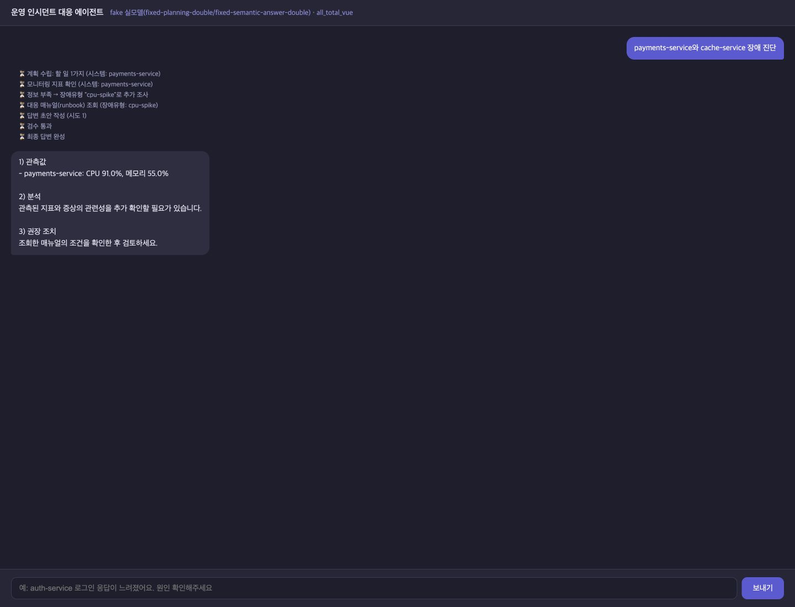
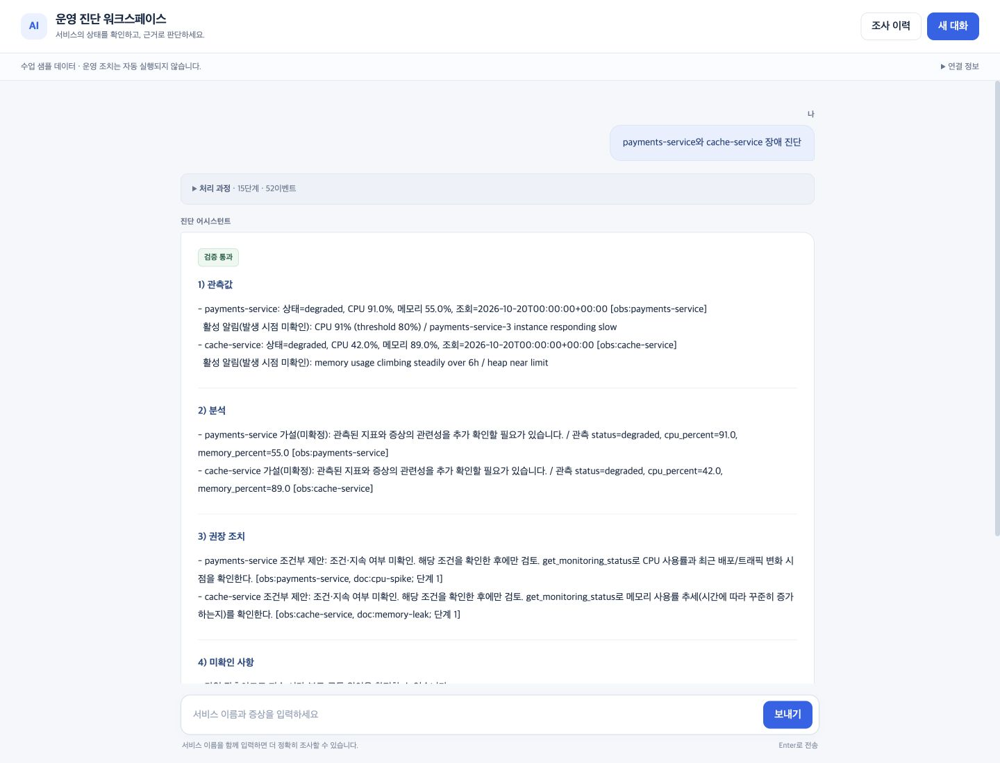

# OpsCheck 최종 평가 검증 보고서

검증 실행: `verification-20261022-084843` · 코드 `4257de1` · 2026-10-22  
범위: 현재 코드 검증·새 증거 수집. 소스·기존 문서·사용자 서버·Git 이력은 변경하지 않았다. 점수는 예측하지 않는다.

**판정 요약:** 고정 자동 검사와 기본 기능 통합은 통과했다. 실제 모델 대표 진단 3건 중 2건은 진단 완료 기준을 충족했고 auth 복합 사례 1건은 실패했다. 세 사례 모두 오류를 강제 통과시키지 않는 안전 기준을 충족했다. RAG 검색은 미구현이며 기존 PPT·ZIP은 최신 코드와 일치하지 않는다. 소수 실제 모델 사례를 전체 정확도로 해석하지 않는다.

## 1. 주제 간단 설명

**OpsCheck는 서비스 상태와 대응 매뉴얼을 확인해 근거가 연결된 진단 보고서를 제공하는 운영 지원 도우미다.** 사용자가 서비스와 증상을 입력하면 조사 계획을 세우고 MCP로 관측·매뉴얼·표준 절차를 조회한다. 수치·출처·조치 조건을 검사한 결과를 저장하고 이전 조사와 비교하거나 Markdown으로 내려받는다. 서비스 재시작·배포·복구 조치는 실행하지 않는다.

모니터링은 수업 샘플이며 CPU·메모리에 임의 변동이 있다. 실제 모델+실제 MCP 검사는 실제 운영 시스템의 원인·복구 효과 검증과 다르다. PDF의 진행 계획 표에 나온 RAG·HITL·전문 서브에이전트는 가상 예시이며 모두 필수라고 해석하지 않았다. 이번 최종 발표 순서·5분/준비 포함6분·전후 화면 필수 조건은 사용자가 추가로 준 최종 기준을 따른다.

## 2. 기능 개선 사항과 추가 포인트

| 구분 | 항목 | 이번 실행 판정 | 증거 |
|---|---|---|---|
| I1 개선 | 조사 대상·계획 검증 | 통과. 누락·중복·범위 밖 작업 보정, 미등록/미지정 대체 금지 | [26개 SSE 사례](../eval/results/verification-20261022-084843/integration/fixed-sse-cases.json) · [대상 7/7](../eval/results/verification-20261022-084843/after-components.json) |
| I2 개선 | 서비스별 복수 매뉴얼 | 선택 통과. auth 경계 5개에서 문서 집합 일치. 실제 auth는 선택된 CPU 문서의 조치가 생성 단계에서 누락 | [복합 매트릭스](../eval/results/verification-20261022-084843/integration/auth-compound-matrix.json) · [실모델 실패](../eval/results/verification-20261022-084843/live/live-auth-compound.json) |
| I3 개선 | 근거 검증·재작성 상한 | 안전 차단 통과. 오류 초안7/7 차단, 정답0/2 오차단. 실모델 auth 답변 완성도는 실패 | [전후 판정](../eval/results/verification-20261022-084843/before-after-comparison.csv) |
| I4 개선 | 개별 실패·시간/생성 한도 | 통과. 성공 관측 보존·실패 대상·전체 실패·시간 초과·종료 확인 | Python phase3/phase10 · [부분 실패 화면](../eval/results/verification-20261022-084843/captures/retry-rewrite-final.jpg) |
| I5 개선 | 대화 유지·후속 질문 | 통과. 대상 확인 후 원래 증상 연결, 같은 대화 재조회·새 대화 격리·DB 재연결 | SSE 29턴 · [맥락 유지](../eval/results/verification-20261022-084843/captures/history-context-preserved.jpg) |
| F1 추가 | 근거 보고서 5개 영역 | 통과. 실패 시 관측·한계·출처와 검증 미통과 표시. 진단 완료 여부는 별도 | [실모델 통과 보고서](../eval/results/verification-20261022-084843/captures/real-model-multiple-final.jpg) |
| F2 추가 | 전체/현재 조사 이력·상세 | 통과. 전체20→33, 중복0, 현재 대화2. 기존 API·원래 대화 ID 유지 | [브라우저 판정](../eval/results/verification-20261022-084843/captures/browser-checks.json) |
| F3 추가 | 이전·현재 관측 비교 | 통과. CPU91→71=-20%p, 메모리55→50=-5%p, 60초 간격. 복구 단정 없음 | [실제 표시](../eval/results/verification-20261022-084843/captures/comparison-followup.dom.txt) |
| F4 추가 | Markdown 다운로드 | 통과. 실제 브라우저 파일=선택 기록 API 바이트, 올바른 원래 ID·변화량 포함 | [다운로드 대조](../eval/results/verification-20261022-084843/browser/download-verification.json) |

Phase8은 정답 검증셋39개(자동 판정35·연결 계약4), Phase9는 전체 이력/커서/맥락 격리, Phase10은 실제 단계 진행과 저장 과정이다. SSE 요청 추적 ID 연결과 텍스트 스트리밍 보완도 이번 검사 범위에 포함했다. 테스트·평가는 별도 사용자 기능으로 중복 계산하지 않는다.

## 3. 사용한 기술 요소와 구현 화면

### 3.1 실제 적용·기존 기반·개선의 연결

| 기술 | 적용 상태 | 기존 기반 / 개선 부분 | 코드 위치 | 실행·검사 결과와 증거 | 한계 |
|---|---|---|---|---|---|
| Multi-Agent | 일부 적용 — 역할 분담 Supervisor 패턴 | 기존 계획·조사·분석·작성 역할 / 계획 게이트·자료 전달·검증 보강 | [plan](</Users/hyeonmin/workspace/AI mini-project/agent/graph.py:140>) · [research](</Users/hyeonmin/workspace/AI mini-project/agent/graph.py:182>) · [analysis](</Users/hyeonmin/workspace/AI mini-project/agent/graph.py:320>) · [write](</Users/hyeonmin/workspace/AI mini-project/agent/graph.py:341>) | 실제 복수 진단에서 plan→MCP 조사→analyze→write 호출. [실제 모델 호출](../eval/results/verification-20261022-084843/live/api-calls.json)와 SSE·외부 trace 확인 | 모든 노드를 독립 에이전트라고 부르지 않는다. research는 MCP 작업, validate/gate는 코드이며 자율 전문 서브그래프는 없음 |
| MCP | 구현·실행 확인 | 기존 stdio ops/docs의 Tool·Resource·Prompt / 문서별 근거·실패 처리·진행 연결 | [MCPClient](</Users/hyeonmin/workspace/AI mini-project/agent/mcp_client.py:45>) | 새 실모델3건에서 실제 stdio 모니터링·Resource·Prompt 호출. [호출 기록](../eval/results/verification-20261022-084843/live/mcp-calls.json) | FixedMCP 대역 검사와 구분. 샘플 데이터이며 첫 Tool 호출 오류는 기존 의도적 시뮬레이션. 기존 Lock 유지 |
| RAG | BM25·임베딩 RAG 미구현 | 원본의 한 문서 선택 / 서비스별 규칙과 복수 문서 연결로 개선 | [select_runbooks](</Users/hyeonmin/workspace/AI mini-project/agent/runbook_selector.py:27>) | 알림 패턴·CPU80/메모리90 기준으로 문서 유형 선택 후 MCP URI 조회. 경계/유형/정상 검사 통과 | 검색 인덱스·임베딩·BM25·의미 검색 없음. 문서 연결을 검색 정확도 향상으로 발표하지 않음 |
| 의존성 주입 | 구현·교체 실행 확인 | 기존 SupervisorDeps / 고정·실제 모델·MCP·임시 DB 교체 검사 확대 | [SupervisorDeps](</Users/hyeonmin/workspace/AI mini-project/agent/deps.py:12>) · [build_graph](</Users/hyeonmin/workspace/AI mini-project/agent/graph.py:416>) | 고정 모델+FixedMCP, 실제 OpenAI+실제 MCP, 임시 SQLite로 같은 그래프/API 실행. 저장소 재연결 검사도 통과 | 새 DI 프레임워크 아님. 현재 노드 래퍼는 deps=deps로 전달하며 오래된 partial 설명과 구분 |
| LangSmith | 구현·실제 외부 수집 확인 | 기존 노드/모델/MCP 추적 / SSE 생성기 내부 요청 루트·조사 ID 연결 보완 | [chat_stream](</Users/hyeonmin/workspace/AI mini-project/server.py:235>) · [_save_result](</Users/hyeonmin/workspace/AI mini-project/server.py:136>) | 로컬 SDK on/off·동시·취소/오류 검사와 기존 외부3건의 요청/하위 호출/저장 ID 일치. [익명화 근거](../eval/results/verification-20261022-084843/langsmith/read-only-redacted.json) | 추적 성공은 답변 품질·LLM-as-judge가 아님. 새 검증의 외부 업로드는 껐고 기존 추적만 읽음 |
| 모듈화 | 구현·경로 확인 | 기존 서버/어댑터/저장소 / targets·selector·report·comparison·progress 책임 분리 | source-code-anchors.json · agent 모듈들 | 그래프가 해당 모듈을 호출하고 기능·API 회귀 검사 통과. [코드 위치](../eval/results/verification-20261022-084843/source-code-anchors.json) | orchestration은 graph.py에 집중. 모든 노드를 별도 파일/서브그래프로 분리하지 않음 |
| 단위·통합 테스트 | 구현·이번 실행 통과 | 초기에 검사 부족 / 함수·어댑터·그래프·API·MCP·네트워크 검사 추가 | tests/ 및 eval/ | Python130 메서드·Node1스크립트·검증셋35. [검사별 분류·위치](../eval/results/verification-20261022-084843/test-inventory.json) | 130개를 전부 단위 테스트라고 부르지 않음. 코드 커버리지·실제 LLM 일반화 정확도 미측정 |
| SSE·Vue 텍스트 | 구현·진행 중 도착 확인 | 기존 SSE/Vue / 단계ID·시도·실패·저장 과정·실제 OpenAI delta와 표시 큐 | [OpenAI 어댑터](</Users/hyeonmin/workspace/AI mini-project/agent/openai_llm.py:60>) · [write](</Users/hyeonmin/workspace/AI mini-project/agent/graph.py:341>) · [revealText](</Users/hyeonmin/workspace/AI mini-project/web_chat.html:351>) | 장벽 중 running·빠른 완료·초안 도착, 오류 복귀, Node 프레임 검사, 데스크톱/390px 확인 | 모델 생성 스트림과 검증 후 보고서 표시 연출을 구분. 배포 프록시의 무버퍼 전달은 미보장 |

**정보 전달:** 계획의 작업 목록→research의 서비스별 관측·매뉴얼→선택적 analysis의 미확정 요약→write의 구조화 JSON→validate의 수치·출처·조건 대조→코드 기반 보고서 순서다. LLM-as-judge·LangSmith Dataset/Feedback 자동 평가와 HITL 운영 조치 승인은 구현하지 않았다.

### 3.2 이번 자동 검사와 통합 검사

| 층위 | 결과 | 해석 |
|---|---|---|
| Python unittest | 130 메서드 통과, 종료0 | 순수 함수·저장소·어댑터·그래프·API·실제 MCP·루프백 네트워크가 섞인 합계 |
| Node | 1개 스크립트 통과, 종료0 | Vue/네트워크 대역의 화면 상태·프레임 검사. 실제 브라우저 검사는 아래 별도 |
| 정답 검증셋 | 35 자동 판정 통과, 4 연결 계약 | 26대화+9초안. 연결 계약4는 Python 통합 검사 참조이며 39개 전부 자동 채점으로 표현하지 않음 |
| 추가 SSE/SQLite 통합 | 26대화 사례·29턴 통과 | 기존 회귀10시나리오·11메시지 포함. 고정 모델/MCP이며 실모델 정확도 아님 |
| auth 경계값 | 79.9/80/89.9/90/95의 5개 통과 | CPU80 미만은 지연 문서, 80 이상은 CPU+지연 문서. 완전한 고정 초안은 모두 통과 |
| auth 조치 누락 주입 | 안전 차단 통과·진단 불완전 | CPU 조치를 두 번 빠뜨리면 unverified, 최종 분석·조치 없음. 성공으로 강제 집계하지 않음 |

명령·종료 코드·stdout/stderr는 [실행 목록](../eval/results/verification-20261022-084843/automatic-summary.json)과 `commands/`, `logs/`에 보존했다. 기대값을 프로그램 출력에 맞춰 바꾸지 않았다. `test_http_success_or_nonempty_answer_is_not_enough`도 통과했다. 같은 사례가 unittest와 데이터셋 실행에 중복되므로 합산 정확도를 만들지 않는다.

### 3.3 허용된 실제 OpenAI 검증 — 새 진단 정확히 3건

현재 설정의 **gpt-4o-mini / gpt-4o**, 실제 MCP stdio 서버, 별도 SQLite를 사용했다. 재작성은 기존 최대2회만 허용했으며 질문을 재실행하지 않았다. auth의 CPU만 실제 Tool 조회 후85%로 고정해 복합 조건을 보장했고 이 주입을 기록했다. 다른 관측은 실제 수업 MCP의 변동 값을 그대로 사용했다. 이는 실제 모델·프로토콜과 통제된 샘플 관측을 사용한 검사다.

| 사례 | 진단 완성도 | 안전성 | 실제 API 호출 | API 보고 토큰 |
|---|---|---|---:|---:|
| live-auth-compound | 실패 — 검증 미통과 | 통과 | 3 | 5,008 |
| live-multiple | 통과 | 통과 | 3 | 3,476 |
| live-text-stream | 통과 | 통과 | 2 | 2,168 |
| 합계 | 2건 완료·1건 실패 | 3건 기준 충족 | 8 | 10,652 |

실제 호출은 fast4회·quality4회이고, auth는 두 번 작성해도 CPU 매뉴얼 조치를 누락했다. 나머지 두 사례는 범위·문서·조치·수치·출처·5영역을 충족했다. API usage는8회 모두 확보했으며 가상 단가 cost_usd를 청구액으로 사용하지 않았다. **2/3을 전체 정확도나 성공 확률로 일반화하지 않는다.** 가설의 의미 전체를 자동 검증했다고도 표현하지 않는다.

실제 초안은 작성 완료보다 각각 약1.27초·2.13초·1.21초 먼저 도착했다. 이는 같은 실행의 수신 시각 차이이며 개선 전후 속도 향상이 아니다. 초기 수집 도구가 `[DONE]`에서 닫는 스트림의 EOF 시각을 남기지 못해 만든 false 플래그는 원시 결과에 보존했고, 저장된 텍스트/작성 완료의 monotonic 시각을 [별도 재분석](../eval/results/verification-20261022-084843/live/streaming-timing-reanalysis.json)했다. 추가 모델 호출은 없었다.

### 3.4 구현 기능·최종 화면 증거

| 캡처 | 확인 내용 | 실행 조건 |
|---|---|---|
| [작업 중 상태](../eval/results/verification-20261022-084843/captures/running-before-slow-release.jpg) | payments 완료가 cache 진행 중일 때 이미 표시 | 대기 장벽·고정 MCP |
| [작성 중 초안](../eval/results/verification-20261022-084843/captures/draft-before-writer-release.jpg) | 작성 장벽 해제 전 `추가 확인이 필요한` 접두사 도착 | 실제 현재 SSE·고정 작성 대역 |
| [실패·재작성 결과](../eval/results/verification-20261022-084843/captures/retry-rewrite-final.jpg) | cache 시도1/2 실패, 초안 반려→재작성 통과·부분 결과 | 장벽 대기 중 기존10초 제한이 적용돼 부분 실패로 종료 |
| [작성 오류 뒤 입력 복귀](../eval/results/verification-20261022-084843/captures/writer-error-input-restored.jpg) | 미완성 출력 대기 큐 폐기·최종 미통과·보내기 복귀 | 작성 중 예외 주입 |
| [후속 질문·비교](../eval/results/verification-20261022-084843/captures/comparison-followup.jpg) | 동일 대화 재조회·CPU -20%p/메모리 -5%p | 고정 두 시점 |
| [전체 이력 더 보기](../eval/results/verification-20261022-084843/captures/history-more.jpg) | 20→33·고유33, 현재 대화2 | 25개 페이지용 fixture+실모델 저장3+고정 실행5 |
| [저장 처리 과정·다운로드](../eval/results/verification-20261022-084843/captures/saved-process-and-comparison.jpg) | 종료 상태·저장 비교·원래 대화/조사 링크 | 과거 기록 재열람 |
| [다른 기록 열기 후 맥락](../eval/results/verification-20261022-084843/captures/history-context-preserved.jpg) | payments 보고서를 열어도 현재 cache 후속 질문 유지 | 별도 대화 |
| [새 대화](../eval/results/verification-20261022-084843/captures/new-conversation-isolation.jpg) | 전역 이력이 있어도 대상 확인 | 새 맥락 |
| [실모델 auth 실패](../eval/results/verification-20261022-084843/captures/real-model-auth-unverified.jpg) | CPU85·문서2종은 있으나 최종 권고 없음 | 이번 실제 모델 결과를 임시 이력으로 열기. 새 호출 아님 |
| [실모델 최종 보고서](../eval/results/verification-20261022-084843/captures/real-model-multiple-final.jpg) | payments/cache 각각의 관측·분석·조치·출처 | 이번 실제 모델 저장 결과 |
| [390px 최종 화면](../eval/results/verification-20261022-084843/captures/mobile-real-model-final.jpg) | 페이지 폭390=뷰포트390, 가로 넘침 없음 | 실제 모델 저장 결과·모바일 |
| [모바일 미통과](../eval/results/verification-20261022-084843/captures/mobile-unverified.jpg) | 반려·재작성 한도·최종 미통과 구분 | 고정 오류 초안 |

단계별 실시간성은 완료된 목록 순서만으로 판정하지 않았다. Event 장벽의 unittest/실제 루프백 프록시 검사와 위 브라우저 중간 캡처를 함께 사용했다. 브라우저에서는 조사 해제 승인 대기 중 cache가 실제10초×2회 제한으로 실패했다. 이 경로는 부분 실패·재시도 증거이며 느린 작업의 정상 완료로 표시하지 않았다. 정상 해제 경로는 phase10 통합 검사에서 통과했다. 최종 보고서의 점진 표시는 검증 후 브라우저 연출이다.

## 4. 동일 입력 Before/After 수치와 화면

**새 실행 결과:** 원본 v2 보존사본과 현재 v2에 동일 평가기·계획·고정 관측·오류 조건을 주입했다. 각 버전의 구성요소33개를1회씩 검사했다. 원본의 의도적0.35초 지연과 모델/출력 계약 차이 때문에 elapsed_seconds를 속도 개선 수치로 사용하지 않는다.

| 고정 구성요소 지표 | 원본 v2 | 현재 v2 |
|---|---:|---:|
| 요청 대상 계획 일치 | 1/7 | 7/7 |
| 필요 매뉴얼 집합 일치 | 11/15 | 15/15 |
| 없는 문서 충분 판정 방지 | 0/1 | 1/1 |
| 부분 실패 성공 근거 보존 | 0/1 | 1/1 |
| 오류 초안 차단 | 0/7 | 7/7 |
| 정답 초안 오차단 — 낮을수록 좋음 | 0/2 | 0/2 |

검증기는 같은 의미의 오류/정답을 **원본 자유형 문장과 현재 JSON**으로 표현했다. 동일 문자열 비교가 아니며 JSON 형식만 깨뜨린 오류가 아니다. 대상/문서/부분 실패의 분모와 검증기 오류7·정답2를 분리했다. 전체 파이프라인의 실제 LLM 정확도나 모델 생성 성능으로 확대하지 않는다.

**화면 비교:** 같은 질문 `payments-service와 cache-service 장애 진단`, 같은 고정 관측과 누락 계획(payments 작업만 존재), 같은1440×1100 뷰포트로 원본/현재의 실제 HTML과 전체 그래프를 실행했다. 원본은 payments만 조사했고 현재는 cache를 보완했다. 계획 대역은 같고 답변 대역은 각 버전 계약에 맞춘 같은 취지의 고정 응답이다. 화면 비교는 범위 보정 재현에 사용하며 실제 모델 전후 평가라고 표현하지 않는다. 원본 화면의 `fake 실모델` 문구는 원래 UI 표시일 뿐 실제 모델 검사를 뜻하지 않는다.





수치: [원본 JSON](../eval/results/verification-20261022-084843/before-components.json) · [현재 JSON](../eval/results/verification-20261022-084843/after-components.json) · [비교 CSV](../eval/results/verification-20261022-084843/before-after-comparison.csv) · [화면 비교 조건](../eval/results/verification-20261022-084843/browser/before-after-screen-pair.json). 공정한 실모델 전후 속도·실제 청구액·검색 순위 정확도는 **미측정**이다.

## 5. 한계·트레이드오프와 발견한 결함

### 5.1 최우선 결함 — auth 복합 증상의 조치 누락

- **재현:** CPU85%, p95지연·커넥션 풀 알림을 가진 auth에 CPU+지연 문서가 조회됐다. 두 작성에서 모두 `auth-service/doc:cpu-spike` 조치가 빠졌다. validator는 이를 반려하고2회 후 unverified로 종료했다. [새 실제 재현](../eval/results/verification-20261022-084843/live/live-auth-compound.json).
- **과거 기록:** 최근30개 조사에서 같은 auth 미통과4건을 읽기 전용 확인했다. 기존 기록/실패는 보존하고 질문 원문·실제 추적 ID는 복사하지 않았다. [익명화 과거 기록](../eval/results/verification-20261022-084843/historical/auth-failures-redacted.json).
- **분리 판정:** 검증기의 안전한 차단은 통과, 정상 진단 요청의 완성도는 실패다. 매뉴얼 선택 자체가 실패한 것이 아니라 **선택된 모든 문서의 조치가 작성되지 않은 것**이다.
- **원인 근거:** [작성 프롬프트](</Users/hyeonmin/workspace/AI mini-project/agent/report.py:67>)는 유효한 ID/단계를 지시하지만 모든 서비스·문서 쌍을 빠짐없이 작성하라는 목록을 명시하지 않는다. [검증기](</Users/hyeonmin/workspace/AI mini-project/agent/report.py:141>)는 실제로 모든 쌍의 조치를 요구한다. 이 계약 차이는 누락을 유발할 수 있는 코드상 요인이다. 모델 내부의 이유를 확정한 것은 아니다.
- **최소 수정안(미적용):** 기존 evidence에서 `required_action_pairs`를 계산해 프롬프트 입력에 명시하고 각 쌍당 조건부 조치1개를 요구한다. 누락 쌍을 재작성 피드백에 구조화해 전달하고 완전/누락 auth 초안 회귀를 추가한다. 검증 조건을 약화하거나 빠진 조치를 임의 생성해 강제 통과시키지 않는다. 이후 같은 모델 확인에는 새 승인이 필요하다.

### 5.2 설계 선택과 검증의 경계

| 선택 | 얻은 점 | 남은 한계·재검토 조건 |
|---|---|---|
| 매뉴얼6종 규칙 | 설치/검색 인프라 없이 재현 가능 | BM25/임베딩 RAG 없음. 표현·문서 증가 시 규칙 확장 또는 검색을 공정 비교 |
| 문서 선택 CPU80% | 주의 관측에 대응 자료 제공 | 런북 조치의 `90% 초과+지속`과 다른 기준. 선택이 조치 조건 충족을 뜻하지 않음 |
| 구조·수치·출처 검증 | 잘못된 주장/연결/조치 차단 | 가설의 의미 전체를 보장하지 않음. 안전한 unverified도 사용자 답변 완성 실패일 수 있음 |
| 작성2회·1024토큰·기한 | 무한 반복/과다 생성 억제 | 복합 요청에서 필요한 조치 누락·잘림 가능. 이번 auth 출력은213토큰씩으로 잘림이 원인은 아니었음 |
| SQLite·전역 이력 | 설치 단순·맥락/조사 분리 | 인증 없는 개인 실습. 같은 서버 접근자의 전체 기록 조회 가능. 다중 사용자/다중 쓰기 서버 부하 미검증 |
| 두 관측 비교 | 변화량·알림 차이를 코드로 제공 | 추세·재발·복구 확정 없음. 시각·자료 부족 시 비교 보류 |
| 초안 공개+점진 표시 | 작성 과정을 확인 가능 | 미검증/반려 문장 노출. 표시 연출은 실제 생성이나 속도 향상과 다름 |
| 기존 MCP Lock | 공유 stdio 연결의 기존 동작 유지 | 실제 MCP 호출 내부 직렬화 가능. 무조건 동시 처리 성능 향상을 주장하지 않음 |

### 5.3 제출 자료와 설명의 최신성

- 기존 PPT는10장이고 `107개 검사`, 과거3건 통과·7,861토큰을 설명한다. 당시 결과는 보존하되 이번130개·실모델2건 완료/1건 실패·10,652토큰과 혼용하면 안 된다. Phase9/10과 추적/텍스트 보완도 최신 설명에 포함해야 한다.
- 기존 UI ZIP은 비교한129개 중15개, 원래 ZIP은126개 중16개 파일이 현재와 다르다. 신규 progress/답변 스트리밍 검사/검증셋 등의 누락 목록도 [ZIP 대조](../eval/results/verification-20261022-084843/submission/zip-current-comparison.json)에 있다. **이번에 PPT·ZIP을 수정하거나 재생성하지 않았다.**
- `regression_test_queries.md`의 미구현/DB 삭제/ID 변경과 README의 과거 Phase별 현재 대화 설명은 현재 기준으로 읽으면 혼동된다. 현재 코드는 전역 이력·DB 보존이다. 최신 Phase/검증 결과를 따르도록 제출 설명을 정리해야 한다. `graph.py`의 오래된 partial 설명과 현재 deps 전달 래퍼도 구분한다.
- PPT는 OOXML 텍스트와 파일을 검사했으며 이번에 PowerPoint에서 시각 검토하거나 실제5분 낭독을 측정하지 않았다.

## 부록 A. 교수님 평가 항목별 근거

| 항목 | 이번 검증 결과 | 증거 | 남은 문제 |
|---|---|---|---|
| 기능 구현 완성도30 | 고정 기능 통과, 실제 모델 auth 복합 실패 | 2절·SSE26사례·브라우저·live3건 | 필수 CPU 매뉴얼 조치 누락 |
| 기술 요소30 | 역할 분담·실제 MCP·DI·추적·모듈·테스트 실행. RAG 검색 미구현 | 3.1 기술표·코드 위치·실제/대역 구분 | RAG/자율 전문 에이전트/LLM-as-judge로 과장 금지 |
| 한계·트레이드오프20 | 재현 실패·샘플/규칙/검증/비용/접근 경계 명시 | 5절·익명화 실패·실제 usage | 실제 운영/확장·의미 품질 미검증 |
| 보고서·발표20 | 교수님1~5순서의 이 문서와7장·280초 대본 초안 | [PRESENTATION_DRAFT_20261022_084843.md](PRESENTATION_DRAFT_20261022_084843.md) · captures/ | 실제 낭독·최종 PPT 갱신 필요 |
| 전후 보너스10 | 같은 조건 구성요소33개/버전과 실제 전후 화면 확보 | 4절·비교 CSV·1440쌍 | 실제 LLM 종합 정확도/속도/청구액 전후 미측정 |

## 부록 B. 재현 명령·결과 위치

모든 원시 실행 명령·시각·종료 코드는 `commands/*.json`, 출력은 `logs/*.stdout.log`/`stderr.log`에 있다. 코드/데이터/평가기/제출물 SHA256는 manifest와 각 평가 JSON에 기록했다. 시작 커밋은 `4257de1e3536417bf9ea0af235f70a3b6801475b`이며 원본은 baseline/original의 수업 v2 보존사본이다. 실제 모델3건의 ledger가 있으므로 이 실행 폴더에서 재실행하지 않는다.

```bash
.venv/bin/python -B -m unittest discover -s tests -v
node tests/test_web_session.cjs
.venv/bin/python -B eval/run_validation.py --output <새 경로>/validation.json
.venv/bin/python -B eval/run_final_eval.py --source baseline/original --output <새 경로>/before.json
.venv/bin/python -B eval/run_final_eval.py --output <새 경로>/after.json
```

수업 근거: [평가표 PDF](</Users/hyeonmin/Downloads/AI-Mini-Project_20261004_2.pdf>), 물리적13쪽/인쇄12. 가상 예시는 물리적11~12쪽. 사용자 제공 최종 안내가 발표 순서·시간·화면 필수 조건을 보완한다. [OpenAI 공식 스트리밍 계약](https://developers.openai.com/api/reference/resources/chat)은 delta/usage 해석에만 사용했다.

실행 종료 시 보존 검사와 비밀 값 검사 결과는 `preservation-final.json`, `privacy-scan.json`으로 별도 남긴다. 사용자 서버를 재시작하거나 소스·기존 문서·제출물·과거 결과를 덮어쓰지 않는다.
