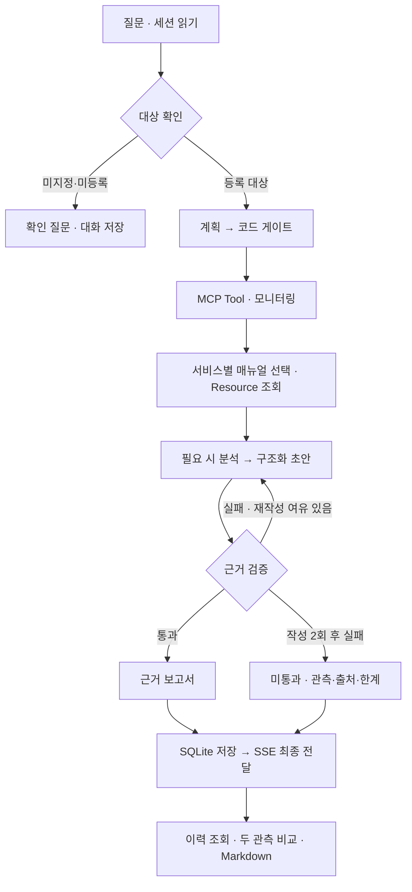

# 최종 결과 보고서 — AI 운영 장애 진단

작성일: 2026-10-21 · 과제: 기존 프로그램 개선·기능 추가  
상태: **개선 5개·추가 4개 구현 및 로컬 최종 검증 완료. 외부 등록·제출은 사용자 확인 필요.**

## 1. 주제와 해결할 문제

사용자가 서비스의 이상 증상을 말하면 MCP로 상태 정보와 대응 매뉴얼을 조회하고, 근거를 확인한 진단과 조건부 권장 조치를 제공한다. 결과를 저장해 이전 조사와 비교하고 Markdown으로 내려받을 수 있다. 수업의 FastAPI·LangGraph·MCP·SSE·SQLite 기반 프로그램을 개선했다. 서비스 재시작·배포 등 운영 조치를 실행하는 기능은 없다.

원본은 모델 계획의 조사 범위를 확인하지 않았고, 관측 전체에서 매뉴얼 한 개만 고르는 구조였다. 답변 검사는 길이·번호 중심이었으며 반복 실패 시 강제 통과가 있었다. 교육용 fake 모델의 추가 대상·의도적 초안 실패를 실제 모델의 일반적 성질로 확대하지 않는다.

## 2. 구현 범위

| ID | 구분 | 구현 | 주로 확인할 파일 |
|---|---|---|---|
| I1 | 개선 | 조사 대상 확인, 누락·중복·범위 이탈 보정, 미등록 대상 대체 금지 | `agent/targets.py`, `agent/graph.py` |
| I2 | 개선 | 정상·정보 부족을 구분하고 서비스별 복수 매뉴얼 연결 | `agent/runbook_selector.py`, `agent/graph.py` |
| I3 | 개선 | 구조화된 주장·문서·조치 조건 검증, 재작성 1회, 반복 실패 미통과 | `agent/report.py`, `agent/graph.py` |
| I4 | 개선 | 개별 조회 실패 격리, 시간·생성·재시도 상한, 오류 안내·종료 | `agent/execution.py`, `agent/retry.py`, 모델 어댑터, 서버·프록시 |
| I5 | 개선 | 같은 DB·대화 ID의 복원, 확인 질문·후속 질문을 이전 대상과 연결해 새 조사 | `agent/session_store.py`, `server.py`, `web_chat.html` |
| F1 | 추가 | 관측값·분석·권장 조치·미확인 사항·출처의 근거 보고서 | `agent/report.py` |
| F2 | 추가 | 조사 UUID·원형 근거·최종 상태 저장, 세션별 목록·상세 | `agent/session_store.py`, `server.py`, 화면·프록시 |
| F3 | 추가 | 같은 서비스의 이전·현재 CPU/메모리 %p·상태·알림 비교 | `agent/comparison.py` |
| F4 | 추가 | 저장된 보고서·검증 상태·샘플 안내·비교의 Markdown 다운로드 | `agent/report.py`, 서버·프록시·화면 |

## 3. 처리 흐름과 수업 기술



| 기술 | 기존 기반과 이번 적용 |
|---|---|
| FastAPI·수명 관리 | 기존 lifespan 공유 객체 유지. 새 이력·비교·다운로드 API 연결 |
| LangGraph·Supervisor | 기존 역할 노드 유지. 대상 게이트·서비스별 문서 보완·실제 근거 검증 수정 |
| Multi-Agent 패턴 | 기존 research/analysis/write 역할 분리를 활용. 새 전문 서브에이전트를 만들었다고 주장하지 않음 |
| MCP | 실제 stdio 서버의 Tool·Resource·Prompt 및 서버 탐색 구조 활용 |
| SSE·Vue 3 | 기존 실시간 진행 화면에 검증 상태·실패·이력·비교·다운로드 연결 |
| 의존성 주입 | 기존 `SupervisorDeps`를 활용해 고정 모델·MCP·DB 대역으로 재현 |
| SQLite | 기존 메시지 저장을 보강하고 조사 원형 근거·비교 스냅샷 추가. LangGraph 체크포인터와 구분 |
| 테스트·평가 | Python 107개, Node 화면 상태 검사, 고정 노드 전후 평가 JSON/CSV |
| LangSmith | 기존 추적 코드 유지. 최종 실제 추적 화면·외부 평가 데이터셋 확인은 미완료 |

## 4. 개선 전후 측정

| 고정 검사 | 원본 v2 | 개선 v2 | 판정 기준 |
|---|---:|---:|---|
| 대상 계획 일치 | 1/7 | 7/7 | 누락·중복·범위 밖 대상 없이 요청 대상과 일치 |
| 필요한 매뉴얼 집합 일치 | 11/15 | 15/15 | 기대 문서가 모두 있고 불필요한 문서 없음 |
| 없는 문서를 충분한 근거에서 제외 | 0/1 | 1/1 | `Runbook Not Found`를 충분한 자료로 취급하지 않음 |
| 일부 조회 실패 시 성공 결과 보존 | 0/1 | 1/1 | 성공 관측과 실패 대상 안내 자료를 모두 유지 |
| 오류 초안 차단 | 0/7 | 7/7 | 잘못된 수치·상태·교차 근거·없는 문서/단계·조건 단정 차단 |
| 올바른 초안 오차단 | 0/2 | 0/2 | CPU·상태가 맞는 고정 정답을 반려한 건수. 낮을수록 좋음 |

**방법:** 동일 평가기·고정 입력으로 원본 v2(`baseline/original`)와 개선 v2를 별도 프로세스에서 실행했다. 원본 29개 파일의 보존 해시를 검사한다. 모델 생성 효과를 제외하기 위해 gate/replan/research/validate 노드를 직접 호출했다. 대상 추출·분류·전체 연결은 별도 회귀·통합 검사에서 확인한다.

**검증기 비교의 차이:** 원본은 자유형 문장, 개선판은 JSON 계약이다. 같은 의미의 정답·오류를 각 계약으로 표현했으며 **동일 문자열 비교가 아니다**. 개선판의 틀린 초안도 JSON 형식 자체는 유효하게 만들어 수치·출처 검사로 차단되는지 확인한다. 오류 주입 표본 7건·정답 2건은 작으므로 일반화된 오류 탐지율을 뜻하지 않는다.

**발표할 수 있는 결론:** 준비한 고정 사례에서 범위 보정·문서 선택·오류 차단·부분 실패 처리가 개선되었다. 실제 LLM 종합 정확도 100%, 특정 배수의 속도·비용 향상을 주장하지 않는다. 원본 research에는 인위적 0.35초 지연이 있어 평가기의 `elapsed_seconds`는 진단용 원시값으로만 남겼다. 실모델 속도 전후 비교는 미측정이다.

재현 명령(프로젝트 루트):

```bash
.venv/bin/python -B -m unittest discover -s tests -v
node tests/test_web_session.cjs
.venv/bin/python -B eval/run_final_eval.py --source baseline/original --output /tmp/phase7-before.json
.venv/bin/python -B eval/run_final_eval.py --output /tmp/phase7-after.json
```

원시 결과: [원본 JSON](../eval/results/phase7-before.json) · [개선 JSON](../eval/results/phase7-after.json) · [원본 CSV](../eval/results/phase7-before.csv) · [개선 CSV](../eval/results/phase7-after.csv). 전체 33개 노드 검사를 단일 정확도로 합산하지 않는다.

기존 `run_eval.py`의 21개 fake 흐름 평가는 그대로 보존했다. 최신 그대로의 기대값으로 18/21이며 두 `clarify` 분기와 ‘없는 문서는 가져올 수 없음’의 기대 차이 3건을 실패로 센다. 기존 원본의 4/21과 비교해 실제 모델 정확도 상승으로 발표하지 않는다. 최종 평가기는 이 기준 불일치를 숨기지 않고 검사 목적·계약을 분리했다.

## 5. 최종 검증 결과

| 구분 | 확인 결과 | 근거 |
|---|---|---|
| Python | 107개 통과, 예상 실패 없이 종료 | `dev_logs/20261021-phase7/tests.log` |
| Node | 대화 복원·중복 전송·SSE 종료·검증 상태·이력·비교·다운로드 검사 통과 | `dev_logs/20261021-phase7/ui-tests.log` |
| 실제 MCP·브라우저 | 확인 질문 → auth 진단, cache 실패 주입 후 payments 보존, 새 관측 비교, 이력·다운로드·재시작 복원 | `dev_logs/20261021-phase7/browser-*.png`, `browser-verification.json` |
| 실제 OpenAI 전체 흐름 | 아래 진단 3건 passed, 확인/미등록/이름 4건 확인 | `dev_logs/20261021-phase7/live-smoke.json` |

### 실제 MCP + OpenAI 관찰

실제 `gpt-4o-mini`·`gpt-4o`와 원래 MCP stdio 서버를 연결했다. 사용자 DB와 별개인 임시 DB를 사용하고 LangSmith 추적은 껐다. 진단은 아래 3건이며 그 외 서비스 확인·미등록·이름 4건을 검사했다. 통과는 구조·근거 검사 기준이다.

| 사례 | 경로 | 검증 상태 | 관측 시간(초) |
|---|---|---|---:|
| payments-service 결제 응답이 느려지고 CPU가 치솟았어요, 원인 확인해주세요 | SSE | passed | 3.686 |
| 그 서비스 다시 확인해줘 | POST | passed | 2.951 |
| payments-service랑 cache-service 둘 다 저하됐는데 공통 원인이 있는지 분석해줘 | SSE | passed | 6.773 |
| billing-service 응답이 느려요 | SSE | 대상 확인/일반 대화 · 검증 해당 없음 | 0.004 |
| 로그인 응답이 느려요, 원인 확인해주세요 | SSE | 대상 확인/일반 대화 · 검증 해당 없음 | 0.775 |
| 제 이름은 민수입니다 | POST | 대상 확인/일반 대화 · 검증 해당 없음 | 0.005 |
| 제 이름이 뭐였죠? | POST | 대상 확인/일반 대화 · 검증 해당 없음 | 0.004 |

실제 모델 호출은 fast 5회·quality 3회, 총 8회다. API가 보고한 토큰은 총 7,861개다. 청구액은 미확인이고 코드의 가상 단가 비용은 실제 비용으로 쓰지 않았다. 요청별 1회 관찰이며 같은 입력 3회 반복 성능 실험이 아니므로 중앙값·속도 개선을 계산하지 않았다. 모델이 달라지면 같은 결과를 보장하지 않는다.

제출 전 비밀 값 검사에서 `.env.example`에 들어 있던 실제 키를 제거했다. 실행용 `.env`는 변경하지 않았고 값은 기록하지 않았다. ZIP 생성 전에 차단하고 포함 파일 전체를 실제 비밀 값과 대조해 검사했다.

## 6. 설계 선택과 한계

- **샘플 데이터:** 실제 운영 로그·장애 원인·복구 효과를 검증한 서비스가 아니다. MCP의 수치 임의 변동을 개선 성과로 발표하지 않는다.
- **문서 선택:** 매뉴얼 6종에 대한 규칙 기반 선택이다. 임베딩·BM25 RAG를 구현했다고 설명하지 않는다. 새로운 표현과 장애 유형은 규칙·데이터 보완이 필요하다.
- **검증 범위:** 구조·서비스·typed claims 수치·출처·조치 단계·미확인 조건 표시는 검사하지만 가설 문장 의미 전체를 판정하지 않는다. `passed`는 원인 확정이나 무오류 보장이 아니다.
- **모델과 생성 한도:** quality 출력은 1,024토큰으로 제한한다. 긴 복합 보고서가 잘리면 안내 응답으로 끝날 수 있다. 이번 소수 사례 통과가 모든 복합 질문의 성공을 보장하지 않는다.
- **저장·접근:** SQLite 단일 서버 실습이다. `thread_id`는 조회 범위 구분이며 인증 수단이 아니다. 다중 서버 공유·동시 쓰기 부하는 실험하지 않았다. 기존 채팅은 새 원형 관측 이력으로 소급 생성하지 않는다.
- **비교:** 직전·현재 두 성공 관측의 차이만 계산한다. 추세·복구·재발 판정은 없다. offset 없는 수업 MCP 시각은 한국 시간으로 해석하고 그 사실을 표시한다.
- **스트리밍·취소:** 초안 가설은 ‘검증 전’으로 표시된다. 최종 결과와 구분하지만 초안을 완전히 숨기는 방식은 아니다. HTTP 취소가 외부 모델 내부 추론·과금을 즉시 중지하는지는 미확인이다.
- **외부 평가:** LangSmith 계층 추적 코드는 기존 기반에 남아 있으나 이번 최종 확인은 추적을 껐다. 실제 SSE 추적 캡처·Dataset/Feedback 등록·외부 시트 제출은 미수행이다.

자세한 결정과 재검토 조건은 [ADR](ADR.md)에 정리했다.

## 7. 발표와 제출

- 발표: [10장 PPT](../submission/AI_Mini_Project_Presentation.pptx), [발표 대본·질문 답변](PRESENTATION_SCRIPT.md).
- 시연: payments 진단 → 그 서비스 재확인 → 조사 이력 → Markdown 다운로드. 추가로 대상 미지정·미등록 안내를 확인한다.
- 사용자 확인: [제출 체크리스트](SUBMISSION_CHECKLIST.md). Google Sheet 등록·소스 주소·보고서/PPT 업로드와 접근 권한·실제 제출은 아직 완료로 표시하지 않는다.
- 수업 기반 코드를 활용하고 이번 개선 부분을 설명한다. 구현 지원 도구를 썼다는 이유로 검증하지 않은 독자 설계·직접 구현 기여를 과장하지 않는다.

## 후속 UI 변경

진단·평가 수치는 유지하고 읽기 쉬운 밝은 화면·보고서 영역·이력 상세·모바일 배치를 적용했다. Node 검사와 실제 MCP+fake 브라우저 확인을 추가했다. 제품 기능·서버·DB·모델 계약은 변경하지 않았다. [UX 변경 기록](UX_CHANGELOG.md) · [최신 UI 제출 ZIP](../submission/AI_Mini_Project_Submission_UI.zip). 기존 PPT의 캡처는 변경 전 UI다.
