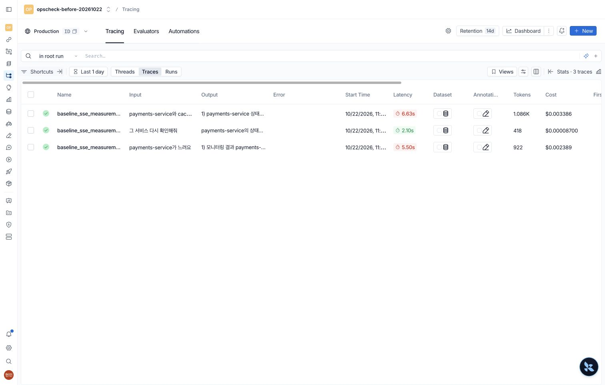
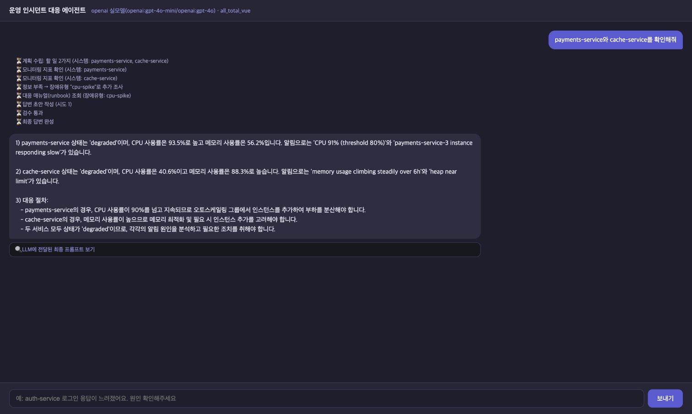

# 개선 전 LangSmith 실측 결과

증거: [원시 결과·CSV·캡처 폴더](../eval/results/langsmith-before-20261022-110948/README.md)

측정: 2026-10-22 11:09~11:10 KST · 원본: 수업 제공 `all_total_vue_student` 프로젝트(`baseline/original/`과 같은 계열) · 각 질문 1회 · 실제 OpenAI/MCP 실행

**이번 결과에서 확인한 핵심:** 단일·복수 대상 자체는 조사했지만, 복수 서비스의 메모리 매뉴얼 조회가 누락됐다. 후속 질문은 이전 수치를 재사용하고 새 조사를 수행하지 않았다. 과거의 조사 대상 누락·auth 대체 기록은 이번 실행에서 재현되지 않았다.

## 1. 측정 조건

- 모델: 분류·계획·일반 대화 `gpt-4o-mini`, 작성 `gpt-4o`, 원본 `temperature=0`.
- 실행 경로: 실제 Chrome의 원본 `web_chat.html` → 원본 `/chat/stream` → LangGraph v2 → 실제 stdio MCP → OpenAI API.
- 첫 질문과 후속 질문은 같은 브라우저 대화, 복수 서비스는 새 브라우저 탭의 새 대화. thread ID는 `requests.json`에서 대조.
- 원본 소스는 바이트가 같은 임시 사본에서 실행했고, 원본·기존 서버·기존 DB를 수정/재시작하지 않았다.
- 원본 SSE에는 요청 루트 추적이 없어 측정 전용 ASGI 래퍼로 `baseline_sse_measurement`를 추가했다. OpenAI HTTP에 토큰 계측 스팬만 추가했다. 조사·분류·재시도·작성·검증 로직은 바꾸지 않았다.
- 원본 MCP의 샘플 데이터와 임의 변동값을 그대로 사용. 고정 관측 대역/운영 서버 실측이 아니다. 실제로 받은 관측값을 사례별 저장했다.
- 원본 `research` 작업당 0.35초의 교육용 고정 지연과, 서버 첫 Tool의 의도적 Timeout·재시도도 유지했다. 첫 단일 요청에는 재시도 1회가 포함된다.
- 사용자 개발 환경에 설치된 `.venv` 의존성을 공용으로 사용했다. 새 패키지를 설치하지 않았다.

## 2. LangSmith 측정값

| 사례 | 요청 시간 | 실제 모델 호출 | 입력 토큰 | 출력 토큰 | 합계 토큰 |
|---|---:|---:|---:|---:|---:|
| 단일 서비스 | 5.495초 | 3 | 726 | 196 | 922 |
| 같은 대화의 재확인 | 2.105초 | 2 | 364 | 54 | 418 |
| 복수 서비스 | 6.625초 | 3 | 785 | 301 | 1086 |

**합계: 사용자 질문 3회, 실제 OpenAI HTTP 호출 8회, 2,426토큰.** 그래프 노드·LLM 역할·측정용 자식 스팬을 각각 별도 모델 호출로 합산하지 않았다. 토큰은 OpenAI 응답 `usage`와 LangSmith 루트 집계가 세 사례 모두 일치한다.

요청 시간은 LangSmith 루트의 `end_time - start_time`이다. Chrome 클릭·렌더링 시간이나 LLM 단일 호출 시간과 다르다. 로컬 타임스탬프는 보조 증거이며 주 수치로 대체하지 않았다.

화면의 Cost는 LangSmith의 모델 단가 기반 **추정값**이다. 실제 청구액으로 제시하지 않는다. 원본 코드의 가상 혼합 단가 `cost_usd`도 실비 비교에서 제외한다.

## 3. 사례별 기대와 실제

| 항목 | 기대 | 실제 | 판정 |
|---|---|---|---|
| 단일 조사 대상 | payments만 조회 | payments 조회 | 충족 |
| 단일 매뉴얼 | CPU 알림 → cpu-spike | cpu-spike 조회 | 충족 |
| 단일 보고서 | 관측값·분석·권장 조치·미확인 사항·출처 | 1)~3) 번호형 서술. 5개 영역·명시적 출처 URI 없음 | 개선 필요 |
| 후속 질문 | payments 대상으로 새 MCP 조회 | chat 분기. MCP 0회, 과거 CPU95.0%를 “여전히”라고 답함 | 미충족 |
| 복수 조사 대상 | payments/cache 모두 조회 | 두 서비스 모두 조회 | 충족 |
| 복수 매뉴얼 | CPU용 cpu-spike + 메모리용 memory-leak | cpu-spike만 조회 | 미충족(1/2) |
| 복수 보고서 | 두 서비스·서비스별 매뉴얼/출처·5개 영역 | 두 서비스 수치는 포함. memory-leak 출처 및 5개 영역 없음 | 일부 충족 |

기대 매뉴얼은 현재 출력이 아닌 원본 관측 알림·매뉴얼 본문으로 정했다. payments CPU 알림은 CPU 매뉴얼, cache의 지속 메모리 증가·heap near limit 알림은 메모리 누수 매뉴얼에 해당한다. 메모리 88.3%는 “90% 이상 즉시 재시작” 조건이 아니며, 추세·힙 덤프·누수 패턴 점검이 우선이다.

진단 요청 2건의 조사 대상 집합은 2/2 일치. 필요한 매뉴얼 집합은 단일 1/1, 복수 1/2. 후속 재조회는 0/1. 이는 세 사례의 관측 결과로, 전체 정확도 추정이나 확률적 실패율로 일반화하지 않는다.

### 실제 관측값

| 사례 | 서비스 | 상태 | CPU | 메모리 |
|---|---|---|---:|---:|
| 단일 서비스 | payments-service | degraded | 95.0% | 57.0% |
| 복수 서비스 | payments-service | degraded | 93.5% | 56.2% |
| 복수 서비스 | cache-service | degraded | 40.6% | 88.3% |

후속 질문에는 새 관측이 없다. CPU95.0%는 첫 질문의 값을 재사용한 것이다. 새 상태를 확인했다는 근거로 삼으면 안 된다.

### 스트리밍·검증 해석

- 원본 OpenAI 작성은 전체 응답이 돌아온 다음 `on_token(content)`를 한 번 호출한다. 각 질문의 AnswerToken 이벤트도 1개였다. 모델의 점진 생성 스트리밍이 아니다.
- 단일·복수 모두 1차 초안에서 “검수 통과”. 원본 기준은 길이≥30 + `1)` 포함이며, 매뉴얼 누락·출처·조치의 조건까지 검증한 통과가 아니다.
- 두 진단 답변은 CPU “90%를 넘고 지속”을 전제로 확장 조치를 단정했지만, 단일 시점 CPU와 CPU80% 임계치 알림만으로 90% 초과 지속 시간까지 입증하지는 못한다.
- 후속 질문은 auth로 바뀌지 않았다. 그렇다고 재점검에 성공한 것도 아니다. “payments를 기억함”과 “payments를 새로 조회함”을 구분한다.

## 4. LangSmith에서 확인하는 방법

프로젝트: `opscheck-before-20261022`. 아래 run은 해당 계정의 접근 권한이 필요하며 공개 공유 링크를 생성하지 않았다. 저장소에는 링크를 싣지 않고 프로젝트 이름·시각·trace ID만 남겼다.

- 단일 서비스 — payments-service가 느려요: 비공개 계정의 LangSmith 프로젝트 `opscheck-before-20261022`의 루트 `baseline_sse_measurement` (2026-10-22 11:09 KST 무렵, trace ID는 `langsmith-spans.json`/`measurements.json`)
- 같은 대화의 재확인 — 그 서비스 다시 확인해줘: 비공개 계정의 LangSmith 프로젝트 `opscheck-before-20261022`의 루트 `baseline_sse_measurement` (2026-10-22 11:10 KST 무렵, trace ID는 `langsmith-spans.json`/`measurements.json`)
- 복수 서비스 — payments-service와 cache-service를 확인해줘: 비공개 계정의 LangSmith 프로젝트 `opscheck-before-20261022`의 루트 `baseline_sse_measurement` (2026-10-22 11:10 KST 무렵, trace ID는 `langsmith-spans.json`/`measurements.json`)

1. 루트 `baseline_sse_measurement`를 선택하면 질문·최종 답변·전체 시간을 확인한다.
2. `mcp.call_tool`의 `arguments.system_name`과 성공 outputs를 확인하면 실제 조사 대상을 검증할 수 있다.
3. `mcp.read_resource`의 `uri`로 CPU 매뉴얼만 읽었는지 확인한다. 후속 trace에는 MCP 호출이 없다.
4. `measurement.openai_http`는 측정용 자식 스팬이다. 토큰은 API 응답 usage에서 기록했으며, 상위 `openai_fast.*`/`openai_quality.*`와 중복 호출로 세지 않는다.
5. 루트 성공 표시는 요청 실행 성공이다. 진단 내용의 완성도/정확도가 합격이라는 뜻은 아니다.

## 5. 캡처와 원시 증거

| 파일 | 내용 |
|---|---|
| `captures/01-single-before.jpg` | 단일 질문·payments 조사·CPU 매뉴얼·번호형 답변 |
| `captures/02-followup-before.jpg` | 같은 대화의 후속 답변. 새 조회 없는 과거 값 재사용 |
| `captures/03-multiple-before.jpg` | 두 서비스 조회 + cpu-spike만 조회한 처리 과정·답변 |
| `captures/04-langsmith-multiple-trace.jpg` | 실제 LangSmith 복수 요청 추적 트리 |
| `captures/06-langsmith-metrics.jpg` | 세 루트의 Latency·Tokens·Cost 추정값 |
| `measurements.json` / `.csv` | 요청별 시간·토큰·관측·매뉴얼·실제 결과 |
| `langsmith-spans.json` | LangSmith에서 읽은 스팬 ID·부모 관계·시간·선택 입력/출력 |
| `api-calls.json` | 실제 모델·사용 토큰·HTTP 호출별 시간. 키/헤더 제외 |
| `requests.json` | SSE 이벤트·도착 시각·질문·최종 답변. 프롬프트 필드 제외 |
| `assessments.json` | 요구사항 기반 기대/실제/판정 및 사유 |
| `manifest.json` / `preservation.json` | 실행 조건·원본 해시·보존 확인 |

## 6. 개선 후 비교 시 유지할 조건

- 단일→같은 대화의 후속→새 대화의 복수 순서를 유지하고, 질문은 완전히 동일하게 사용한다.
- 모델·의존성·MCP 연결·추적 범위를 맞춘다. 개선판은 원래의 요청 루트를, 개선 전은 본 측정용 루트를 비교한다. 래퍼 오버헤드는 별도로 제거하지 않았다.
- 원본 동적 샘플의 관측 수치가 재실행마다 바뀐다. 정확한 같은 관측 비교가 필요하면 저장한 관측을 두 버전에 동일하게 재생하는 별도 실험을 진행한다. 실제 MCP 실행과 대역 재생을 혼동하지 않는다.
- 첫 Tool의 의도적 실패·0.35초 교육용 대기 조건을 명시한다. 이 조건이 다른 실행을 단순 속도 개선율로 계산하지 않는다.
- 후속 질문은 개선 전이 재조사 자체를 생략해 더 빨라도 기능 목표를 충족하지 못한다. 빠른 응답만으로 우수하다고 해석하지 않는다.
- 보고서 5개 영역/출처, 서비스별 필요 매뉴얼, 후속 재조회 여부를 우선 비교하고 시간·토큰은 추가 작업량과 함께 설명한다.
- 각 질문 1회 측정이며 평균·p95·정확도·비용 절감률을 계산하지 않았다. 개선 후는 이번 작업에서 새로 호출하지 않았다.

## 주요 화면

