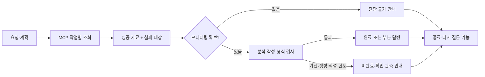

# Phase 3 결과 — 조회 실패와 실행 한도

> Phase 3 완료 당시 기록입니다. 현재 근거 검증·보고서·초안 상태를 구현했습니다. 최신 결과는 [Phase 4 결과](PHASE4_RESULT.md)를 참고합니다.

완료: **2026-10-21 15:10 KST** · 다음: **Phase 4 근거 검증·진단 보고서**

> **일부 조회가 실패해도 성공한 자료는 보존합니다.** 모든 모니터링이 실패하면 진단 불가를 안내하고, 시간 초과·잘린 생성·반복 형식 미달을 성공으로 바꾸지 않습니다. 기존 개선 I4를 구현했으며 개선 5개·추가 기능 4개 범위는 유지합니다.

## 1. 무엇이 달라졌나

| 상황 | Phase 2 | Phase 3 |
|---|---|---|
| payments 성공·cache 예외 | 예외로 전체 조사 중단 | payments 관측 유지 + cache 미확인 표시 |
| 모니터링 전부 실패 | 전체 요청 예외 | 분석·작성 모델 호출 없이 진단 불가 안내 |
| 일시 시간 초과·연결 오류 | 폭넓은 재시도, 호출별 기한 없음 | 재시도 가능한 예외만 시도당 기한·횟수 제한 |
| 실제 모델 응답 대기 | 동기 HTTP가 이벤트 루프 차단 | 비동기 HTTP, 다른 요청 처리 가능 |
| 요청 시간 초과·생성 중단 | 처리 오류·불완전한 종료 가능 | 오류 이벤트 + 이전 노드까지 확보한 관측 안내 + 종료 |
| 짧은 답변 반복 | 세 번째 강제 합격 | 최대 2회 작성 후 미통과·관측 안내 |
| SSE 연결 중단 | 화면 오류·재입력 동작 불충분 | 중단 초안 무효 표시, 오류 안내, 입력 복구 |



실패한 시스템은 조회한 사실처럼 모델에 전달하지 않습니다. 성공 관측과 `monitoring_failure`/`runbook_failure`를 분리하고, 작성 입력에 실패 대상·사유를 전달합니다. 최종 부분 답변에도 실패 대상 안내를 붙입니다. **답변 내용 자체가 사실과 일치하는지 대조하는 검사는 Phase 4입니다.**

## 2. 적용한 실행 한도

| 구분 | 한도 |
|---|---|
| API/SSE 요청 전체 | 120초 |
| 실제 모델 호출 전체 | 45초/회 |
| MCP 개별 시도 | 10초/회 |
| MCP 호출 횟수 | 최대 2회 = 최초 1회 + 재시도 1회 |
| 추가 매뉴얼 조사 | 최대 1라운드, Phase 2 유지 |
| 답변 작성 | 최대 2회 = 최초 1회 + 재작성 1회 |
| fast 모델 출력 | 512토큰 |
| quality 모델 출력 | 1,024토큰 |
| 프록시 SSE 중계 전체 | 130초: 백엔드 종료 안내 수신 여유 포함 |

상수는 [execution.py](../agent/execution.py)에 모았습니다. 제출 전 무기한 실행을 피하기 위한 **초기 정책값**이며, 실제 모델이 이 시간·토큰 안에 항상 완성된다는 성능 측정값이 아닙니다. HTTP 읽기 대기 시간 외에 모델 호출 전체 기한도 적용했습니다. 생성 종료 사유와 Ollama 스트림의 완료 신호를 확인해 잘린 응답을 완료로 취급하지 않습니다.

재시도 대상은 `TimeoutError`·`ConnectionError`·`httpx.TransportError`입니다. 입력 오류·없는 문서·MCP 도구가 반환한 실패는 무조건 재시도하지 않습니다. 모델 호출을 자동 재시도하지는 않습니다. MCP 공유 연결의 비동기 잠금은 유지했습니다. 호출이 일부 직렬화될 수 있으며 병렬 속도 향상은 주장하지 않습니다.

`processing_status`: completed / partial / failed.
`validation_status`: passed / rejected / unverified. **현재 passed는 길이·번호 형식 검사 통과이며 사실 검증 통과가 아닙니다.**

## 3. 검증과 반영

| 검증 | 결과 |
|---|---|
| 수정 전 Python 회귀 검사 | 47개: 44개 통과·기존 결함 3개 예상 실패 |
| 수정 후 Python 검사 | **65개: 64개 통과·수치 검증 1개 예상 실패** |
| Node 화면 로직 | 종료·중복 전송 방지·오류/네트워크 중단·초안 무효 표시·재입력 통과 |
| 실제 MCP stdio 취소 | 시간 초과 후 같은 연결의 후속 호출 성공 |
| 실제 MCP + fake, 별도 포트 | 부분 실패·전체 실패·후속 정상 요청·SSE 종료 확인 |
| 실제 모델 HTTP 대역 | 비동기 계약·생성 상한·중단 감지·전체 기한·HTTP 정리·실패 대상 입력 확인 |
| 임시 브라우저 | 부분 실패 표시, 전체 실패의 진단 불가 안내, 이후 새 질문과 보내기 버튼 복구 확인 |
| 실제 8100·8600 서버 | 정상 재기동·health·새 HTML 확인, OpenAI 설정 유지 |
| 자료 보존 | 기존 메시지 **130개**, 세션 맥락 **13개** 내용·순서 보존, 원본 기준선 29개 해시 일치 |
| 유료 모델 호출 | **0회** |

동일한 고정 `partial-failure` 사례는 **ValueError 중단 → 성공 관측·실패 대상 안내**로 바뀌었습니다. 짧은 답변의 한도 판정은 **강제 합격 → 미통과**입니다. 기존 테스트용 0.35초 인위적 지연을 제거했으므로 검사 소요 시간의 차이를 실제 서비스 성능 향상으로 발표하지 않습니다.

오류는 임시 fixture MCP 서버와 대역에서 주입했습니다. 수업 원본 데이터·실행 서버에 장애를 만들지 않았습니다. 실제 OpenAI 응답의 의미 품질은 이번 단계에서 재측정하지 않았습니다. 기존 메시지를 개발 로그에 복사하지 않고 SQLite 온라인 백업을 `/private/tmp/ai-phase3-doip36f7/before-restart.sqlite3`에 보관했습니다.


### 수정 파일

| 파일 | 역할 |
|---|---|
| `agent/execution.py` | 실행 한도·안전한 오류 이벤트·관측 안내 |
| `agent/retry.py`, `agent/mcp_client.py` | 선택적 재시도·개별 MCP 기한·취소 후 잠금 해제 |
| `agent/graph.py` | 작업별 실패 격리·자료 보존·전체 실패 우회·작성 한도·강제 합격 제거 |
| 모델 어댑터 3종 | 비동기 인터페이스. 실제 어댑터에 호출 기한·생성 상한·종료 확인 |
| `server.py` | 전체 기한·진행 상태 보존·JSON/SSE 오류·취소 전파 |
| `web_demo_server.py`, `web_chat.html` | 프록시 중단 안내·완료 상태 구분·입력 복구 |
| `tests/test_phase3.py` 등 검사 파일 | 새 검사 18개·기존 계약 비동기 전환·해결된 결함 필수 통과로 전환 |

새 외부 패키지나 프론트 빌드 단계는 추가하지 않았습니다. 실행 근거는 `dev_logs/20261021-phase3/`의 `tests.log`, `ui-tests.log`, `before-fixed.json`, `after-fixed.json`, `mcp-smoke.json`, `browser-phase3.txt`, `review.diff`, `status.json`에 있습니다. 이전 소스·문서는 `before/`에 보존했습니다.

## 4. 직접 확인할 것과 남은 작업

[채팅 화면](http://localhost:8600)을 새로고침하면 새 상태 표시가 반영됩니다. `payments-service와 cache-service 장애 진단`으로 두 대상의 조회·매뉴얼·완료를 확인할 수 있습니다. 실제 서버의 샘플 데이터는 기본적으로 정상 반환하므로 **평소 질문만으로 부분 실패를 재현할 수는 없습니다.** 실패 재현은 자동 검사의 오류 주입 또는 개발 로그의 임시 fixture로 합니다.

검사 명령은 프로젝트 루트에서 다음과 같습니다.

```bash
.venv/bin/python -B -m unittest discover -s tests -v
node tests/test_web_session.cjs
```

- **Phase 4:** 수치·서비스·출처·조치 조건 검증, 5개 영역 보고서, 검증 전/반려 초안 표시. 현재 초안은 여전히 검증 전 화면으로 나옵니다.
- **Phase 5~6:** 조사 이력·상태 비교·내보내기. 이번 단계의 대화 저장과 구분합니다.
- **Phase 7:** 최종 전후 평가·발표 자료.
- 앱 작업과 HTTP 정리는 확인했지만 모델 서버 내부 추론·실제 과금이 취소 즉시 중단되는지는 미확인입니다. 부분 조사 결과는 노드 완료 시 보존되므로 노드 내부 수집 중 전체 취소가 먼저 발생하면 그 노드의 미반환 결과는 포함하지 못합니다.
