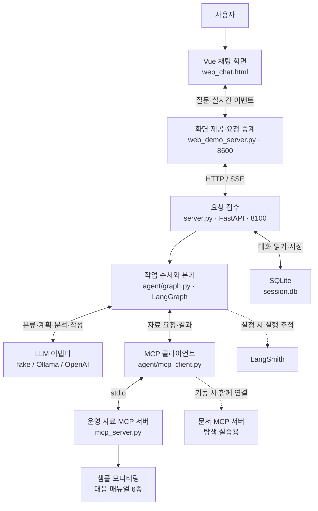
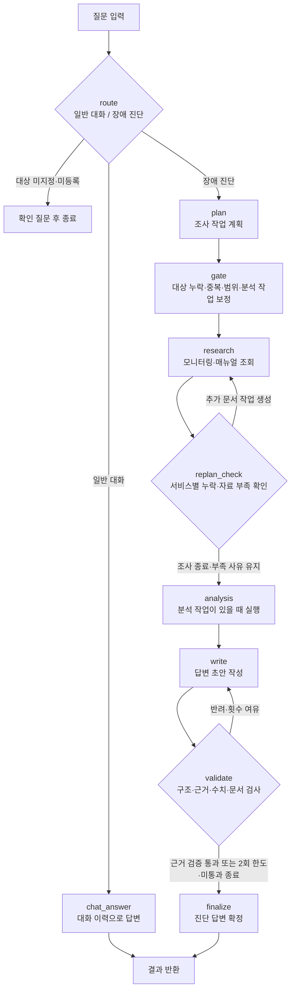
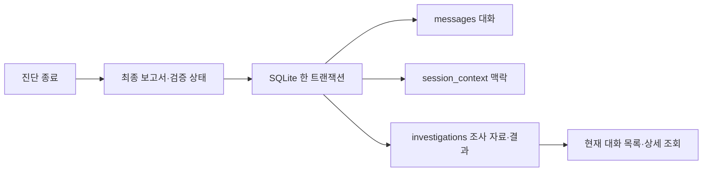

# AI mini-project 이해 가이드

> **주제:** 서비스 장애의 증상을 입력하면, 상태 정보와 대응 매뉴얼을 조회해 진단과 권장 조치를 알려주는 AI 운영 지원 서비스.
>
> **현재 상태:** Phase 0 완료. Phase 1(대상 검증·대화 연결·세션 복원)은 실제 Ollama·브라우저·재시작 복원까지 확인했습니다. Phase 2의 서비스별 매뉴얼 선택·출처 연결·부족 판정을 구현했습니다. Phase 3의 조회 실패·실행 한도·오류 안내를 완료했습니다. Phase 4의 근거 검증·5개 영역 보고서·초안 상태 구분도 완료했습니다. [Phase 4 결과](PHASE4_RESULT.md). Phase 5의 조사 이력 저장·조회도 완료했습니다. [Phase 5 결과](PHASE5_RESULT.md). Phase 6 비교·Markdown 다운로드도 완료했습니다. [Phase 6 결과](PHASE6_RESULT.md). Phase 7 전체 검증·발표 파일도 준비했습니다. 외부 제출은 사용자 확인이 필요합니다. [최종 결과](PHASE7_RESULT.md). [Phase 3 결과](PHASE3_RESULT.md). [Phase 1 결과](PHASE1_RESULT.md) · [Phase 2 결과](PHASE2_RESULT.md).

**확정 일정:** 2026-10-21 18:00 제출, 당일 09:00~18:00 작업 가능. [개발 계획의 9시간 배분안](DEVELOPMENT_PHASE_PLAN.md)을 기준으로 기본 진단 안정화와 평가·제출 준비를 우선합니다.

**실행 준비 완료:** 기본 로컬 모델과 브라우저 채팅을 확인했습니다. [Phase 0 결과](PHASE0_RESULT.md)에 테스트·현재 한계·직접 할 일을 정리했습니다.

작성일: 2026-10-20 · 기준 코드: 프로젝트 루트

**처음에는 1~4번을 읽고 큰 그림을 잡으세요.** 코드를 볼 때는 5번 파일 지도를, 개발할 때는 7~8번을 참고하면 됩니다.

| 읽고 싶은 내용 | 위치 |
|---|---|
| 무엇을 만드는 프로젝트인가? | [1. 주제와 기획](#topic) |
| 기존 계획에 영향이 있는가? | [2. 개발 범위](#scope) |
| 어떤 기술이 무슨 일을 하는가? | [3. 전체 구조](#architecture) |
| 질문 하나가 어떻게 답변이 되는가? | [4. 요청 처리 흐름](#flow) |
| 각 파일은 무엇을 하는가? | [5. 파일 지도](#files) |
| 값과 대화는 어디로 전달되는가? | [6. 데이터와 세션](#data) |
| 무엇을 고치고 추가하는가? | [7. 개선·추가 기능](#features) |
| 어떤 순서로 개발하고 평가하는가? | [8. 개발·평가](#development) |
| 무엇부터 공부하면 되는가? | [9. 읽기 순서](#learning) |

이 문서의 그림은 Mermaid 형식입니다. 지원하는 Markdown 뷰어에서는 흐름도로 표시됩니다. 지원하지 않는 뷰어에서도 바로 아래의 순서표와 설명으로 같은 내용을 확인할 수 있습니다.

## 1. 주제와 기획

### 어떤 상황에서 쓰나요?

서비스 운영 담당자가 다음과 같이 묻는 상황입니다.

> “payments-service 결제 응답이 느려지고 CPU가 치솟았어요. 원인을 확인해주세요.”

담당자는 상태 화면을 보고, 대응 문서를 찾고, 여러 정보를 종합해야 합니다. 이 프로그램은 **상태 조회 → 매뉴얼 확인 → 결과 정리**를 도와줍니다.

| 기획 항목 | 내용 |
|---|---|
| 사용자 | 서비스 상태를 확인하고 장애 대응을 준비하는 운영 담당자 |
| 해결할 문제 | 조사 대상이 여러 개이고, 상태 정보와 대응 문서가 흩어져 있음 |
| 입력 | 서비스 이름과 이상 증상을 적은 자연어 질문 |
| 조사 자료 | 상태·CPU·메모리·알림, 장애 대응 매뉴얼(runbook) |
| 결과 | 관측한 사실, 가능한 원인, 권장 조치와 진단 한계 |
| 우리가 개선할 가치 | 정확한 대상·근거로 답하고, 결과를 저장·비교·공유할 수 있게 하기 |

### 현재 자료는 샘플입니다

지금은 실제 회사 서버에 접속하지 않습니다. 아래 6개 서비스의 **준비된 샘플 데이터**를 읽고, CPU·메모리에 임의 변동값을 더합니다.

| 서비스 | 이해를 위한 역할 | 샘플에 준비된 상태·증상 |
|---|---|---|
| auth-service | 로그인·인증 | 성능 저하, 응답 지연, 커넥션 풀 사용률 92% |
| web-01 | 웹 서버 | 정상, 알림 없음 |
| payments-service | 결제 | 성능 저하, 높은 CPU, 특정 인스턴스 응답 지연 |
| cache-service | 캐시 | 성능 저하, 메모리 증가·힙 한계 알림 |
| gateway-service | 서비스 간 요청 중계 | payments 호출 시간 초과, 패킷 손실 알림 |
| log-service | 로그 관련 서비스 | 디스크 공간 부족 알림 |

역할 설명은 서비스명을 이해하기 위한 설명입니다. 이 폴더에 로그인·결제 서비스 자체의 구현 코드가 들어 있다는 뜻은 아닙니다.

**지원 범위:** 진단과 대응 안내입니다. 매뉴얼에 “로그 확인”, “재시작”, “확장”이 나와도 프로그램이 해당 작업을 실행하는 것은 아닙니다. 현재 MCP Tool은 모니터링 조회 하나이며, 실제 로그 조회·서버 복구 도구는 없습니다.

## 2. 기존 개선사항·추가 기능에 영향이 있나요?

**목표와 개수는 그대로입니다.** 새로 확인한 연결 문제는 기존 기능을 제대로 만들기 위한 보완 작업입니다.

| 이번에 명시한 보완 | 넣은 단계 | 기존 계획과의 관계 |
|---|---|---|
| 설정한 모델과 검사·기동 모델 일치 | Phase 0 | 실행·평가 환경을 정확히 준비 |
| 분석 필요 판단과 분석 작업 일치 | Phase 1 | 조사 계획 검증을 보완 |
| 질문·메모리 관측을 분석 단계에 전달 | Phase 4 | 근거가 있는 분석·보고서의 기반 |

**개선 5개·추가 4개를 다른 기능으로 바꾼 것이 아닙니다.** 연결부를 수정하면서 모델 어댑터와 호출 함수도 맞춰야 하므로, 개발·검증 작업에는 포함됩니다. 기존 기능의 동작 유지 여부는 회귀 테스트로 확인합니다. 일정 영향은 실제 구현을 해보며 점검해야 합니다.

## 3. 전체 구조: 누가 무슨 일을 하나요?

**가운데 길만 먼저 읽으면 됩니다:** 사용자 → 채팅 화면 → 요청 중계 → FastAPI → LangGraph. LangGraph가 LLM과 MCP를 이용해 결과를 만듭니다.

### 자주 나오는 용어

| 용어 | 이 프로젝트에서 하는 일 | 쉬운 기억법 |
|---|---|---|
| Frontend / Vue | 질문 입력, 진행 상황과 답변 표시 | 사용자가 보는 창 |
| FastAPI | 질문을 받아 작업을 시작하고 결과 반환 | 접수 창구 |
| LangGraph | 단계 순서·분기·반복 결정 | 작업 순서표 |
| Supervisor | 역할별 작업을 계획하고 진행시킴 | 진행 담당자 |
| LLM | 질문 분류, 계획·분석·문장 생성 | 판단과 글쓰기를 맡는 모델 |
| MCP | 외부 도구·문서·프롬프트를 요청하는 공통 연결 방식 | 자료 요청 규약 |
| Runbook | 특정 장애에서 확인할 것과 대응 방법을 적은 문서 | 대응 매뉴얼 |
| SSE | 서버가 진행 이벤트와 답변 조각을 계속 전송 | 작업 중계 방송 |
| SQLite | 파일로 대화 기록 저장 | 로컬 기록장 |
| LangSmith | 설정 시 노드·모델·도구 실행 추적. 평가 도구 제공 | Phase 0 로컬 고정 평가 추가. LangSmith 자동 평가 연결은 미구현 |

**LLM과 LangGraph의 차이:** LLM이 “무엇을 조사할지” 제안하면, LangGraph와 Python 코드가 “어떤 순서로 실제 실행할지” 관리합니다. 연결과 검증이 약하면 모델의 잘못된 제안이 그대로 실행될 수 있습니다.

### MCP의 세 가지 역할

| 구분 | 현재 제공 항목 | 하는 일 |
|---|---|---|
| Tool | `get_monitoring_status` | 지정 서비스의 상태·수치·알림 조회 |
| Resource | `runbook://incident-response/{incident_type}` | 선택한 장애 유형의 매뉴얼 본문 읽기 |
| Prompt | `incident_analysis_prompt` | 상태 조회 → 매뉴얼 확인 → 종합이라는 표준 절차 제공 |

Prompt는 작업을 직접 실행하지 않습니다. 계획 모델에 주는 안내입니다. Resource·Prompt는 필요한 항목을 제공하는 MCP 서버를 조회한 뒤 요청하며, 모니터링 Tool은 기본 ops 서버에 요청합니다.

### 모델 세 가지와 역할 두 가지

| 선택 방식 | 의미 | 주의할 해석 |
|---|---|---|
| `LLM_BACKEND=fake` | 정해진 규칙·문장으로 실습 흐름 확인 | 실제 AI 답변 품질을 평가하는 모드가 아님 |
| `LLM_BACKEND=ollama` | 로컬에 설치된 모델 사용 | 장비와 모델 설정에 따라 속도·품질이 달라짐 |
| `LLM_BACKEND=openai` | 외부 API 모델 사용 | 실제 호출 비용 발생 가능 |

한 요청에서 위 세 backend를 모두 쓰는 것은 아닙니다. 하나를 선택한 뒤, 그 안에서 **fast 역할은 분류·계획·분석·일반 대화**, **quality 역할은 진단 답변 작성**을 맡습니다. 역할이 두 개라고 반드시 서로 다른 모델 두 개를 설치해야 한다는 뜻은 아닙니다.

## 4. 질문 하나가 답변이 되는 과정

### 현재 v2 베이스 코드의 흐름

이 그림은 **현재 코드의 동작**입니다. `write`의 초안은 검증 전부터 화면으로 전달됩니다. 초안을 바로 보여주는 것은 스트리밍 설계의 선택이며, 그 자체가 오류는 아닙니다. 다음 두 항목은 구분해서 이해해야 합니다.

| 구분 | 왜 보완하거나 수정하나요? | 개발 계획 |
|---|---|---|
| 검증 전 초안 표시 | Phase 4부터 가설 문장을 ‘검증 전 초안’으로 표시합니다. | 반려 상태·사유를 남기고, 최종 결과와 구분합니다. 일반 대화에는 검증 배지가 없습니다. |
| 반복 실패 종료 | Phase 3에서 강제 합격을 제거했습니다. 최대 2회 작성 후에도 근거 검증 미달이면 미통과입니다. | Phase 4부터 관측·출처·한계만 안내하며 실패한 분석·조치를 제외합니다. |

초안을 숨기고 검증 후에만 답변을 보여주는 것도 가능한 대안입니다. 이번 계획의 기본안은 **초안 스트리밍 유지 + 상태 구분**입니다. 두 방식을 선택하는 별도 설정 기능을 추가하는 것은 아닙니다. 이 정책은 장애 진단 답변에 적용하며, 일반 인사·이름 기억 대화는 기존 경로를 유지합니다. 강제 합격 제거·작성 한도는 Phase 3에 적용했습니다. 초안 상태와 구조화 근거 검증은 Phase 4에 적용했습니다. 가설 의미 전체의 정확성을 보장하지는 않습니다.

| 순서 | 단계 | 무엇을 받아 무엇을 하나요? |
|---|---|---|
| 1 | route | 현재 질문을 일반 대화 또는 장애 진단으로 분류 |
| 2 | plan | 질문과 MCP 표준 절차를 보고 조사 작업 목록 생성 |
| 3 | gate | 요청 대상만 각각 한 번 조사하도록 보정하고 분석 필요 여부에 맞춰 analysis 작업을 0개 또는 1개로 정리 |
| 4 | research | pending 작업 실행. 모니터링 Tool과 매뉴얼 Resource 호출 |
| 5 | replan_check | 서비스별 필요한 문서와 성공 조회를 대조. 누락 문서만 최대 1라운드 보완하고 부족한 채 종료되면 한계를 유지 |
| 6 | analysis | 작업이 있으면 사용자 질문과 CPU·메모리·상태·알림을 함께 분석 모델에 전달 |
| 7 | write | 근거 ID가 연결된 가설·측정 주장·매뉴얼 단계 선택을 JSON으로 작성 |
| 8 | validate | 구조·서비스·수치·문서·조건 표시 검사. 반려 사유로 재작성 최대 1회 |
| 9 | finalize | 코드 기반 5개 영역 보고서. 미통과면 가설·조치 제외 |

**SSE는 별도의 진단 단계가 아닙니다.** 위 작업이 진행되는 동안 이벤트와 답변 조각을 화면에 전달하는 통로입니다. `supervisor_v1.py`는 일부 단계가 없는 별도의 레거시 경로이며, 위 그림은 v2 기준입니다.

### payments CPU 질문으로 이해하기

| 구분 | 확인할 내용 |
|---|---|
| 사용자 요청 | payments-service의 느린 응답과 CPU 문제 조사 |
| 필요한 관측 | payments 상태·CPU·메모리·알림 |
| 필요한 문서 | 관측에 맞는 CPU 대응 매뉴얼. 추가 증상이 있으면 관련 문서 검토 |
| 확인된 사실 | 실제 Tool이 돌려준 수치·상태·알림 |
| 가능한 원인 | 부하 증가 등 가설. 현재 자료만으로 확정할 수 없는 원인은 추정으로 표시 |
| 권장 조치 | 매뉴얼 조건에 맞춰 추가 확인·대응 방법 안내 |
| 확인하지 못한 것 | 실제 로그·최근 배포·장기간 추세 등 |

예를 들어 매뉴얼의 “CPU가 90%를 넘고 지속되면 확장”은 **조건부 조치**입니다. 한 번 높은 값이 나왔다는 이유만으로 지속 상태를 확인했다거나 확장을 실행했다고 말하면 안 됩니다.

## 5. 파일 지도

**코드를 처음 볼 때는 ①화면 → ②접수 → ③작업 흐름 → ④자료 조회 순서로 보세요.** 아래 파일명은 클릭하면 원본을 열 수 있습니다.

### 5-1. 화면과 서버 진입점

| 파일 | 역할 | 연결되는 곳 |
|---|---|---|
| [web_chat.html](../web_chat.html) | Vue 채팅 UI. 질문 전송·SSE 이벤트·답변 표시 | 중계 서버 |
| [web_demo_server.py](../web_demo_server.py) | 화면 제공 및 백엔드 요청 중계. 기본 8600 포트 | 화면 ↔ FastAPI |
| [server.py](../server.py) | FastAPI 진입점. 공유 객체 초기화, API, 그래프 호출, 대화 저장 | 그래프·모델·MCP·SQLite |
| [requirements.txt](../requirements.txt) | 필요한 Python 패키지 목록 | 가상환경 설치 |

화면이 열리는 것과 진단 서버가 동작하는 것은 다릅니다. 화면 서버는 기본 8600, 진단 백엔드는 8100입니다. 웹 화면은 중계 서버를 통해 백엔드에 질문합니다.

### 5-2. agent: 판단과 작업 흐름

| 파일 | 역할 | 기억할 점 |
|---|---|---|
| [graph.py](../agent/graph.py) | v2의 노드·분기·반복을 정의 | 이 프로젝트의 중심 흐름 |
| [runbook_selector.py](../agent/runbook_selector.py) | Phase 2 서비스별 문서 선택·사유·정상/자료 부족 판단 | 수치 기준·활성 알림 규칙. 원인 확정은 하지 않음 |
| [deps.py](../agent/deps.py) | 모델·MCP·저장소 등 필요한 객체를 한 묶음으로 전달 | 테스트 때 가짜 도구로 바꿔 끼울 수 있음 |
| [fake_llm.py](../agent/fake_llm.py) | 정해진 응답으로 분류·계획·작성 등 시연 | 고의 오류·web-01 추가 같은 실습 동작 포함 |
| [ollama_llm.py](../agent/ollama_llm.py) | 로컬 Ollama 모델 호출, 모델 응답을 계획·문장으로 변환 | 실제 모델 backend 중 하나 |
| [openai_llm.py](../agent/openai_llm.py) | OpenAI API 호출과 응답 변환 | 현재는 완성 문장을 한 번에 전달하는 부분이 있음 |
| [mcp_client.py](../agent/mcp_client.py) | 두 MCP 서버 기동·연결, 도구·문서·프롬프트 요청 | 클라이언트는 요청 담당, 데이터 생성은 MCP 서버 담당 |
| [retry.py](../agent/retry.py) | 일시적 시간 초과에 제한된 재시도·대기 적용 | 현재는 asyncio.TimeoutError 중심 |
| [session_store.py](../agent/session_store.py) | SQLite에서 thread_id별 대화 읽기·저장 | 메시지·직전 대상·확인 대기 증상 저장 |
| [supervisor_v1.py](../agent/supervisor_v1.py) | 초기 선형 처리 방식 | v2 개선 전 기준선과는 별개인 레거시 버전 |
| [__init__.py](../agent/__init__.py) | agent 폴더를 Python 패키지로 표시 | 별도 진단 로직 없음 |

**의존성 주입이란?** 함수가 전역 객체를 몰래 가져다 쓰는 대신 필요한 모델·도구를 인자로 받는 방식입니다. 실제 서버 대신 고정 데이터를 주는 도구를 넣어 같은 문제를 반복 검사할 수 있습니다.

### 5-3. MCP 서버와 데이터

| 파일 | 역할 |
|---|---|
| [mcp_server.py](../mcp_server.py) | 실제 진단에 쓰는 ops MCP 서버. 모니터링 Tool·매뉴얼 Resource·표준 절차 Prompt 제공 |
| [mcp_server_docs.py](../mcp_server_docs.py) | 내부 API 문서 Resource를 제공하는 탐색 실습용 서버. 현재 장애 진단 자료로 사용하지 않음 |
| [monitoring.json](../data/monitoring.json) | 등록 서비스 6개와 상태·기준 CPU/메모리·알림 샘플 |
| [cpu-spike.md](../data/runbooks/cpu-spike.md) | CPU 급증 대응 |
| [memory-leak.md](../data/runbooks/memory-leak.md) | 메모리 증가·누수 대응 |
| [high-latency.md](../data/runbooks/high-latency.md) | 지연·커넥션 풀 문제 대응 |
| [network-timeout.md](../data/runbooks/network-timeout.md) | 네트워크 타임아웃 대응 |
| [disk-full.md](../data/runbooks/disk-full.md) | 디스크 공간 부족 대응 |
| [db-down.md](../data/runbooks/db-down.md) | DB 장애 대응 |

두 MCP 서버는 백엔드가 자식 프로세스로 실행하고 표준 입출력(stdio)으로 연결합니다. 8100·8600의 HTTP 연결과 다른 통로입니다.

### 5-4. 실행·배포 스크립트

| 파일 | 역할 | 현재 알아둘 동작 |
|---|---|---|
| [setup_venv.sh](../sh/setup_venv.sh) | 가상환경 생성과 패키지 설치 | 최초 준비용 |
| [setup_ollama.sh](../sh/setup_ollama.sh) | 로컬 모델 확인·다운로드 | 기존 Ollama 프로세스를 종료하는 코드와 선택적 모델 재설정 기능 포함 |
| [run_agent_ollma.sh](../sh/run_agent_ollma.sh) | Ollama 백엔드 기동 | 모델 설정 순서 수정 완료. Phase 1부터 DB 보존 |
| [run_agent_openai.sh](../sh/run_agent_openai.sh) | OpenAI 백엔드 기동 | 실제 API 비용 확인. Phase 1부터 DB 보존 |
| [run_frontend.sh](../sh/run_frontend.sh) | 화면 서버 기동 | 백엔드가 먼저 필요. 기존 8600 포트 프로세스 종료 코드 포함 |
| [make_student_zip.sh](../sh/make_student_zip.sh) | 배포용 ZIP 생성 | .env·가상환경·세션 DB 등을 제외하는 포장 작업 |

설치·모델 준비와 실제 백엔드/프론트엔드 실행을 Phase 0에서 확인했습니다. 기존 Ollama를 종료하는 setup 스크립트 대신 필요한 모델만 준비했습니다. [Phase 0 결과](PHASE0_RESULT.md)에 수행 범위와 남은 결함을 구분했습니다.

### 5-5. 문서와 실행 후 생기는 파일

| 파일·폴더 | 역할 |
|---|---|
| [doc/README.md](README.md) | 수업 베이스 프로그램의 메인 매뉴얼 |
| [manual_ollma.md](manual_ollma.md) | 로컬 모델 사용 예와 기존 캡처 |
| [manual_openai.md](manual_openai.md) | OpenAI 사용 예와 기존 캡처 |
| [regression_test_queries.md](regression_test_queries.md) | 기존 동작을 다시 확인할 테스트 질문 목록 |
| [DEVELOPMENT_PHASE_PLAN.md](DEVELOPMENT_PHASE_PLAN.md) | 앞으로 무엇을 어떤 순서·완료 기준으로 개발할지 정한 문서 |
| PROJECT_GUIDE.md — 이 문서 | 프로젝트를 이해하기 위한 전체 안내 |
| [image_usecase](image_usecase) · [image_usecase_openai](image_usecase_openai) | 위 사용 매뉴얼에서 보여주는 기존 실행 화면 12개. 이번 개선의 측정 결과가 아님 |
| .venv/ | Phase 0에서 준비한 프로젝트 Python 환경 |
| .env | Phase 0에서 만든 키 없는 로컬 설정. 개인 키는 문서·Git에 복사하지 않음 |
| session.db | messages·session_context와 Phase 5 investigations를 보관하는 기존 SQLite 파일 |

추가된 개발 자료는 `baseline/original/`(원본), `tests/`(회귀 검사), `eval/`(고정 평가), `.env.example`(설정 예제), `requirements-phase0.lock.txt`(설치 버전)입니다. `.venv`·`.env`·테스트 대화가 담긴 `session.db`도 현재 생성돼 있습니다.

## 6. 단계 사이에서는 어떤 값이 오가나요?

| 이름 | 뜻 | 예시·용도 |
|---|---|---|
| query | 사용자의 현재 질문 | “payments-service가 느려요” |
| thread_id | 어떤 대화인지 구별하는 ID | 같은 대화를 이어갈 때 같은 ID 사용 |
| history | 이전 user·assistant 메시지 | 최근 10개 역할별 전달. 명확한 이름 질문은 user 발언에서 코드로 확인 |
| tasks | 실제로 수행할 작업 목록 | payments 모니터링 조회, CPU 매뉴얼 조회 |
| collected | 작업으로 수집한 자료 | 모니터링 응답, 매뉴얼 본문, 분석 요약 |
| draft | 작성 중인 답변 | 검증 전 초안 |
| final | 최종 반환할 답변 | 현재는 검증 흐름이 끝난 draft |
| events | 진행 기록 | 계획 생성, 조회 완료, 검증 결과 |

읽는 순서는 **query → tasks → collected → draft → final**입니다. history는 이전 맥락을 제공하고, events는 처리 과정을 보여줍니다. 현재는 history가 장애 계획에 전달되지 않는 등 연결이 부족한 부분이 있어 개선합니다.

### API와 화면의 관계

| 백엔드 API | 목적 | 현재 화면과의 관계 |
|---|---|---|
| `GET /health` | 실행 상태·backend·모델·버전 확인 | 화면 상단 모델 정보에 사용 |
| `GET /version` | v1/v2 확인 | 백엔드 직접 확인용. 현재 화면 프록시에 별도 경로 없음 |
| `POST /chat` | 처리가 끝난 뒤 JSON 답변 반환 | 테스트·API 호출에 사용 |
| `GET /chat/stream` | 진행 이벤트·토큰·최종 답변 전송 | 현재 Vue 채팅이 실제로 사용하는 경로 |

POST 응답에는 `reply`, `events`, `metadata`가 있습니다. SSE는 개별 이벤트와 `FinalAnswer`를 보내고 `[DONE]`으로 끝납니다. 응답 형식이 다르므로 저장·검증 상태의 의미를 맞추는 작업이 필요합니다.

### 이름 기억과 조사 이력은 다릅니다

| 구분 | 대화 저장 | Phase 5 조사 이력 |
|---|---|---|
| 저장 내용 | 누가 무슨 말을 했는가 | 어떤 대상을 언제 조사했고 무엇을 관측했는가 |
| 주요 데이터 | role, content, thread_id | 관측값·알림·매뉴얼·실패·검증 상태·최종 보고서 |
| 활용 | 후속 대화 | 상세 조회·같은 서비스 두 관측 비교·Markdown 다운로드 |

Phase 1부터 일반 기동 시 DB를 보존하고 localStorage로 같은 대화 ID를 사용합니다. 메시지 복원 API, 확인 대기 증상과 직전 대상 저장을 구현했습니다. 로컬 검사와 실제 Ollama·인앱 브라우저에서 DB 재연결·세션 분리·화면 새로고침 및 서버 재시작 후 복원을 확인했습니다. 이전 버전은 ID를 저장하지 않았으므로 과거 캡처의 대화 ID를 자동 복구할 수는 없습니다.

## 7. 무엇을 개선하고 추가하나요?

### 개선 5개: 원래 해야 할 일을 정확하게 만들기

| ID | 개선 | 현재 문제 → 개발할 동작 |
|---|---|---|
| I1 | 조사 대상·계획 검증 | 대상 대체·누락·추가 조사 → 대상 확인과 실행 전 대조 |
| I2 | 시스템별 매뉴얼 선택 | Phase 2 구현: 서비스별 복수 문서·선택 근거·URI 연결, 정상/정보 부족 구분 |
| I3 | 답변 검증 | Phase 3에서 강제 합격 제거. Phase 4 완료: 구조·서비스·수치·출처·조건 표시 검사와 초안 상태 구분 |
| I4 | 조회 실패 처리 | Phase 3 완료: 성공 자료 보존·실패 안내·제한된 재시도·시간/출력 한도·중단 정리 |
| I5 | 대화 유지 | 재시작·새로고침·후속 질문에서 맥락 단절 → 세션 복원과 이전 대상 연결 |

조사 대상은 “무엇을 봤는가”, 매뉴얼은 “무엇을 참고했는가”, 검증은 “근거대로 썼는가”를 책임집니다. 이 세 가지가 먼저 맞아야 보고서를 저장·비교하는 기능도 의미가 있습니다.

### 추가 4개: 결과를 활용할 수 있게 만들기

| ID | 기능 | 사용자에게 생기는 변화 |
|---|---|---|
| F1 | 근거가 연결된 진단 보고서 | 관측값·분석·권장 조치·미확인 사항·출처를 구분해 읽음 |
| F2 | 조사 이력 저장·조회 | Phase 5 완료: 세션별 목록·상세·재시작 복원 |
| F3 | 이전·현재 상태 비교 | 같은 서비스의 직전 성공 관측 1개와 현재 관측의 CPU·메모리·상태·알림 문자열 비교 |
| F4 | Markdown 내보내기 | 같은 보고서를 파일로 저장·공유 |

범위는 **같은 대화·같은 서비스의 두 관측 비교**입니다. 저장된 숫자를 빼고 알림 문자열 집합의 차이를 확인하며, 시계열 추세·차트·이상 탐지·알림 의미 분석은 추가하지 않습니다. 값이 없거나 실패한 항목은 비교 불가로 표시합니다.

예: CPU 90%에서 70%로 바뀌면 **-20%p**입니다. 값이 낮아졌다는 사실과 “완전히 복구됐다”는 판단은 구분합니다. 특히 지금 샘플 데이터의 임의 변동을 실제 복구로 해석하면 안 됩니다.

### 완성 후 보고서의 모습 — 설명용 예시

아래 수치는 실제 실행 결과가 아닌 고정 예시입니다.

> **관측값:** payments-service CPU 91%, 상태 degraded.  
> **분석:** CPU 부하가 지연에 영향을 줄 가능성. 근본 원인은 미확정.  
> **권장 조치:** 높은 CPU가 지속되는지 확인하고, 매뉴얼 조건 충족 시 확장 검토.  
> **미확인 사항:** 실제 로그·배포 변경·지속 시간은 조회하지 못함.  
> **출처:** 해당 조사 모니터링 결과, cpu-spike 매뉴얼.

**보고서 화면·이력·Markdown 파일은 같은 데이터에서 만들어야 합니다.** 서로 다른 답변을 다시 생성해서 표시하는 구조로 만들지 않습니다.

이력과 내보내기는 최종 보고서 및 최종 검증 상태를 사용합니다. 화면에 먼저 나왔던 초안이나 반려된 조치를 검증 완료 결과로 저장·공유하지 않습니다. ‘검증 통과’도 정한 규칙을 충족했다는 뜻이며, 가능한 원인이 모두 사실로 확정됐다는 뜻은 아닙니다.

## 8. 개발 순서와 평가

| Phase | 개발 내용 | 연결되는 범위 |
|---|---|---|
| 0 | 고정 테스트·기준선·모델 설정 일치 | 모든 기능의 검증 기반 |
| 1 | 대상 확인·계획 검증·분석 판단 일치·대화 연결 | I1, I5 일부 |
| 2 | 시스템별 복수 매뉴얼·자료 충분성 — 구현·검사 완료 | I2 |
| 3 | 작업별 실패 격리·시간 제한·오류 안내 | I4 |
| 4 | 분석 입력 보완·근거 검증·보고서 5영역 | I3, F1 |
| 5 | 조사 이력·상세 조회·세션 기능 마무리 | F2, I5 |
| 6 | 전후 비교·Markdown 다운로드 | F3, F4 |
| 7 | 전체 테스트·실측 비교·PPT·코드 설명 | 제출 준비 |

구현할 파일·API와 항목별 완료 기준은 [개발 계획서](DEVELOPMENT_PHASE_PLAN.md)를 기준으로 합니다. 이 가이드는 계획서를 대신하는 새 명세가 아닙니다.

### 평가에서 보여줄 것

| 항목 | 배점 | 준비할 증거 |
|---|---|---|
| 기능 구현 완성도 | 30 | 선택한 개선·추가 기능이 실제로 동작하는 시연 |
| 기술 요소 반영 | 30 | 그래프·MCP·주입·테스트·추적을 어디에 왜 적용했는지 설명 |
| 한계·트레이드오프 | 20 | 자료 부족, 규칙 선택의 한계, 검증 지연 등 |
| PPT·발표 | 20 | 문제 → 변경 → 결과 → 한계 순서 |
| Before/After 실측 비교 | 보너스 10 | 같은 입력·데이터·모델 설정에서 전후 수치 비교 |

코드 수정 전에는 [캡처·수치 증거 체크리스트](BEFORE_AFTER_EVIDENCE.md)를 확인합니다. 노션의 기존 개선 전 캡처는 유지하고 모델 정보·질문·실제 동작을 연결합니다.

예를 들어 payments만 요청했을 때 **범위 밖 조회 건수**, CPU·메모리 복합 장애의 **필요 매뉴얼 포함 여부**, 잘못된 CPU 답변의 **차단 여부**를 비교할 수 있습니다. 아직 개선 후 수치를 측정한 것은 아닙니다.

LangSmith 캡처는 처리 흐름의 증거이며 그 자체가 보너스를 보장하지 않습니다. 오류 초안 차단과 올바른 초안 오차단을 함께 측정하고, 부분 실패는 성공 자료 보존과 실패 안내를 모두 확인합니다. 오류 주입 결과·실모델 관찰·fake 평가 결과도 구분합니다.

SQLite는 단일 서버 실습의 단순성을 위해 유지합니다. 다중 서버에서의 데이터 공유와 쓰기 동시성은 향후 검토할 한계이며 실제 부하 실험으로 확인한 결과가 아닙니다. 현재 메시지 저장소는 LangGraph 체크포인터와 다르므로 `AsyncPostgresSaver`를 바로 교체할 수 있다고 설명하지 않습니다.

기술 이름을 많이 넣는 것보다 동작과 선택 이유를 설명하는 데 집중합니다. 현재 계획의 매뉴얼 선택을 새로 구현한 임베딩 RAG라고 소개하지 않습니다. 기존 Supervisor의 역할 분리와 독립적인 전문 서브에이전트 추가도 구분합니다.

## 9. 무엇부터 읽으면 이해하기 쉬울까요?

| 순서 | 읽을 곳 | 이 질문에 답해보기 |
|---|---|---|
| 1 | 이 문서의 구조·흐름 그림 | 질문은 어디로 들어가고 자료는 어디서 오는가? |
| 2 | [server.py](../server.py) | 요청을 받고 그래프를 실행하는 곳은 어디인가? |
| 3 | [graph.py](../agent/graph.py) | 어떤 순서로 조사·작성·검증하는가? |
| 4 | [mcp_server.py](../mcp_server.py) · [monitoring.json](../data/monitoring.json) | 모델이 수치를 만들어내는가, 도구가 데이터를 읽는가? |
| 5 | [ollama_llm.py](../agent/ollama_llm.py) | 모델에 무엇을 보내고 어떤 응답을 받는가? |
| 6 | [web_chat.html](../web_chat.html) · [session_store.py](../agent/session_store.py) | 화면 표시와 대화 저장은 어떻게 다른가? |

**현재의 첫 학습 목표:** “payments 질문이 들어오면, 서버가 그래프를 실행하고 MCP로 샘플과 매뉴얼을 읽은 뒤 모델이 답변을 작성한다”를 자기 말로 설명하기입니다. 그다음 각 단계에서 빠진 값과 잘못된 판단을 하나씩 고칩니다.

### 발표 때 설명할 프로젝트 소개

> 서비스 장애 증상을 입력하면 모니터링 정보와 대응 매뉴얼을 조회해 진단을 돕는 AI 운영 지원 서비스입니다. 기존 코드의 조사 대상·문서 선택·근거 검증·실패 처리·대화 연결을 개선하고, 보고서·조사 이력을 추가했으며 상태 비교·내보내기도 추가했습니다. 전체 검증·발표 준비가 남았습니다. 현재 데이터는 샘플이며, 실제 운영 서버의 복구를 자동 실행하지는 않습니다.

### 자료의 관계

| 자료 | 쓰는 목적 |
|---|---|
| 이 PROJECT_GUIDE.md | 프로젝트 전체를 이해하기 |
| [PHASE0_RESULT.md](PHASE0_RESULT.md) | 실제 실행·테스트 결과와 직접 할 일 |
| [PREDEVELOPMENT_CHECK.md](PREDEVELOPMENT_CHECK.md) | PDF 실행 순서·환경 준비·문서 정정 결과 확인 |
| [doc/README.md](README.md) | 베이스 프로그램의 원래 설명 확인 |
| [DEVELOPMENT_PHASE_PLAN.md](DEVELOPMENT_PHASE_PLAN.md) | 개발 순서·수정 대상·완료 기준 확인 |
| 수업 실습 폴더(AiCapstone, 저장소에 미포함) | Wave별 실습에서 배운 패턴 참고. 현재 프로젝트 소스와 별개 |

작성 시 소스·데이터·스크립트·계획서의 역할을 대조했습니다. 후속 점검 결과와 연결했으며 프로그램 구현 상태를 완료로 바꾸지 않습니다.

현재 선택 규칙·실행 범위·사용자가 확인할 질문은 [Phase 2 결과](PHASE2_RESULT.md)에 정리했습니다. 부분 조회 예외 처리는 Phase 3에서 구현했습니다. 구조화된 주장 검증과 보고서는 Phase 4에서 구현했습니다.

## Phase 3 — 일부 실패해도 확인한 자료는 남기기

| 상황 | 현재 동작 |
|---|---|
| payments 조회 성공·cache 실패 | payments의 관측을 보존하고 cache 미확인 안내를 함께 반환 |
| 모든 모니터링 실패 | 모델 분석·답변 작성을 건너뛰고 진단 불가 안내 |
| MCP 시간 초과·연결 문제 | 시도당 10초·총 2회 이내. 입력 오류·없는 문서는 재시도하지 않음 |
| 모델/요청 기한·생성 상한 도달 | 불완전한 초안을 완료로 표시하지 않고 확보한 관측만 안내 |
| 근거 검증 2회 실패 | 강제 합격 없이 미통과, 관측 안내로 종료 |
| SSE 중단·프록시 연결 실패 | 오류 표시·종료 후 재입력 가능 |

`processing_status`는 completed/partial/failed, `validation_status`는 Phase 4부터 pending/rejected/passed/unverified입니다. passed는 구조·근거 연결·수치 대조 기준 통과이며 가설의 의미 전체가 정확하다는 뜻은 아닙니다. 초안·반려·최종 상태를 구분합니다.

실행 한도는 `agent/execution.py`, 재시도는 `agent/retry.py`, 부분 실패 결과는 `agent/graph.py`, API/SSE 종료는 `server.py`·`web_demo_server.py`에서 담당합니다. 제한값과 검증 방법은 [Phase 3 결과](PHASE3_RESULT.md)에 있습니다.

## Phase 4 — 보고서의 다섯 칸

| 영역 | 만드는 주체 | 읽는 방법 |
|---|---|---|
| 관측값 | 코드 | 실제 상태·CPU·메모리·조회 시각·활성 알림. unknown의 기본 0은 미확인 처리 |
| 분석 | 모델 + 검사 | 미확정 가설과 같은 서비스의 관측 주장. 자유 문장에 수치를 재입력하지 않음 |
| 권장 조치 | 모델이 단계 선택, 코드가 원문 표시 | 조회한 문서의 조건을 유지. 지속·조치 조건은 미확인으로 표시 |
| 미확인 사항 | 코드 | 조회 실패·부족 자료·단일 관측·알림 시점 한계 |
| 출처 | 코드 | obs:서비스, doc:장애유형 ID와 실제 Tool/Resource URI |

[report.py](../agent/report.py)가 계약·검사·보고서 생성을 담당합니다. 예를 들어 `obs:payments-service`의 CPU가 91이면 claims의 cpu_percent=1은 반려됩니다. gateway 근거를 payments에 붙이거나 문서 ID에 존재하지 않는 값을 넣어도 반려됩니다. 모델은 `doc:cpu-spike`의 단계 번호를 선택하고, 코드는 해당 문장을 조건부 제안으로 표시합니다.

모델 JSON 원문 대신 완성된 가설 문장을 검증 전 초안으로 스트리밍합니다. 반려 사유와 재작성 상태를 보여주며, 최대 2회 실패하면 관측·출처·한계만 제공합니다. 통과한 보고서도 원인을 확정한 것으로 읽지 않습니다. [실제 검증·한계](PHASE4_RESULT.md).

## Phase 5 — 채팅과 별도로 남기는 조사 기록

| 저장하는 것 | 용도 |
|---|---|
| UUID·thread_id·완료 시각·원래/해석된 질문·대상 | 한 번의 조사와 세션 식별 |
| 수집한 관측 원형·조회 시각·문서/실패·샘플 표시 | 당시 자료 재확인, 다음 Phase 비교의 기반 |
| 최종 5개 영역 report·reply·종료/검증 상태·검증 이벤트 | 통과/부분 실패/미통과를 구분해 다시 읽기 |

초안 본문·최종 프롬프트·검증되지 않은 분석 노드 요약을 새 조사 이력에 넣지 않는다. 미통과 report에는 가설·조치를 넣지 않으며 검증 실패 사유 이벤트는 남긴다. 단순 조회는 새로운 MCP 조사나 LLM 호출이 아니다. 이전 기록을 현재 상태로 보여주지 않도록 샘플·저장 시점 안내를 붙인다.

[session_store.py](../agent/session_store.py)가 테이블 생성·중복 방지·저장·목록·상세를 담당한다. server.py의 공통 저장 함수는 POST/SSE 모두 최종 이벤트 전에 커밋하고, web_demo_server.py가 조회 경로를 중계한다. web_chat.html의 ‘조사 이력’에서 같은 대화의 최근 20건과 상세를 확인한다. 새 대화로 전환하거나 다른 기록을 선택한 뒤 늦게 도착한 이전 응답이 화면을 덮지 않도록 확인했다.

기존 채팅은 소급 변환하지 않는다. 같은 로컬 DB 파일을 사용하는 재시작은 복원되지만 DB 파일을 바꾸거나 thread_id를 잃으면 다른 이력으로 보인다. thread_id는 인증이 아니며 다중 사용자 서비스용 접근 제어는 구현하지 않았다. [Phase 5 결과](PHASE5_RESULT.md).

## Phase 6 — 이전/현재 두 관측 비교

| 보여주는 것 | 원칙 |
|---|---|
| CPU·메모리 | 현재−이전, 퍼센트포인트(%p). 90→70은 -20%p |
| 서비스 상태 | 두 상태 라벨을 그대로 나란히 표시 |
| 알림 | 문자열 집합의 추가·삭제·유지. 의미상 실제 장애 발생/해소로 단정하지 않음 |
| 두 관측 시각·간격 | 시각 없거나 역전/동일하면 비교 보류. offset 없는 수업 MCP 시각은 한국 시간 해석 |
| 비교 불가 | 이전 없음·현재 실패·누락 수치를 0으로 대체하지 않고 사유 표시 |

보고서 검증 미통과 여부와 모니터링 관측 성공은 구분합니다. 이전 보고서가 미통과여도 모니터링이 성공한 원형 관측은 비교 대상으로 사용할 수 있습니다. 같은 세션·서비스에서 저장 순서상 가장 최근인 성공 관측 하나를 선택합니다. 실패·unknown·다른 서비스·다른 세션·현재 행·미래 행은 이전 관측이 아닙니다.

새 조사는 comparison을 스냅샷으로 저장하므로 이후 기록이 늘어도 바뀌지 않습니다. Phase 5 기록에는 필드가 없으므로 해당 행 이전만 읽어 비교하며 원래 JSON은 고치지 않습니다. 새 진단 직후 채팅에 표시하고 새로고침 후에는 조사 이력 상세에서 다시 봅니다. 저장 보고서의 Markdown에는 5개 영역·검증 상태·샘플 안내·비교가 함께 들어가며 재조사나 LLM 호출은 없습니다.

[comparison.py](../agent/comparison.py)가 계산, session_store.py가 이전 관측 선택, report.py가 Markdown 변환을 담당합니다. UI의 다운로드 링크와 server.py API, web_demo_server.py의 바이트·헤더 중계를 연결했습니다. 시계열 추세·차트·장애 재발·복구 완료 판정은 추가하지 않았습니다. [실제 검증·한계](PHASE6_RESULT.md).

## 최종 이해·발표에 사용할 자료

Phase 0~7 구현·로컬 검증·발표 파일 준비를 마쳤다. [최종 보고서](FINAL_REPORT.md)는 개선 5개·추가 4개, 기존 기술 재사용과 실제 변경, 전후 측정 조건을 구분한다. [대본](PRESENTATION_SCRIPT.md)에는 10장 PPT 설명·시연·질의응답·읽을 함수가 있다. [ADR](ADR.md)에서 규칙 선택·코드 검증·SQLite의 이유와 한계를 확인한다. 실제 제출은 [체크리스트](SUBMISSION_CHECKLIST.md)를 따른다.
