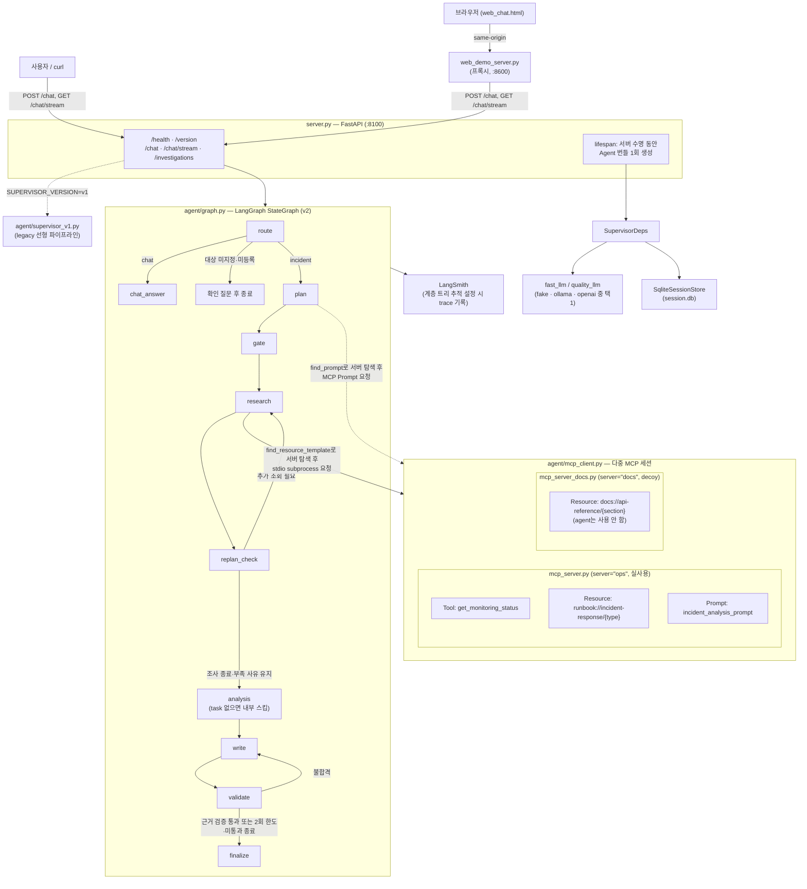
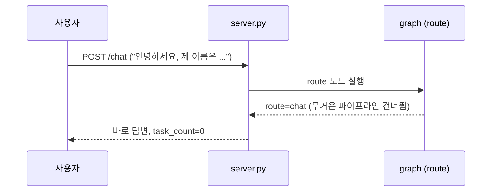
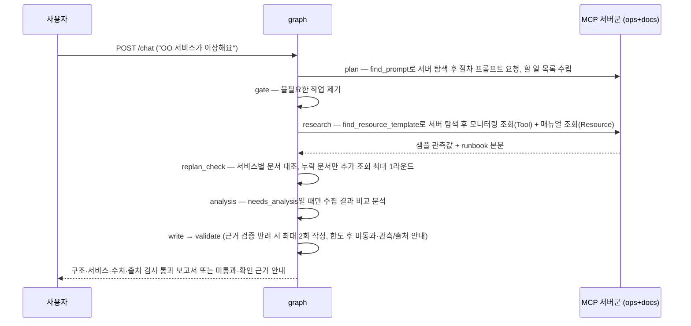
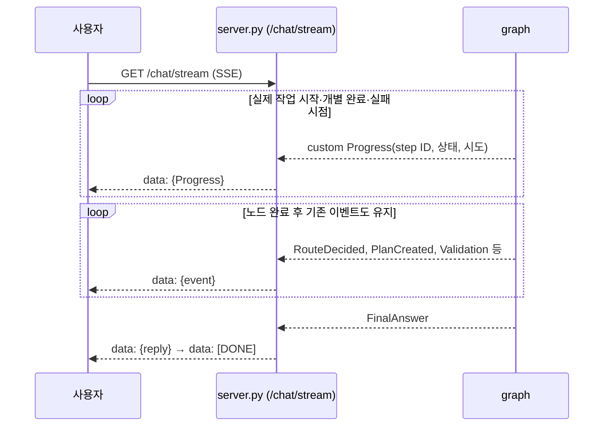
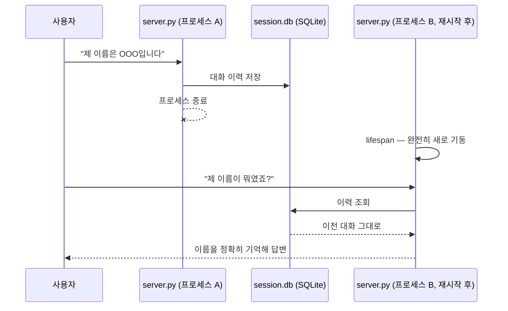
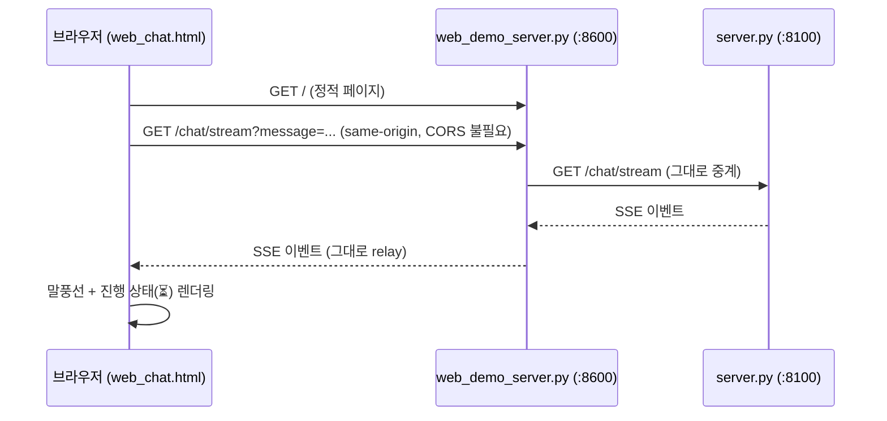

# all_total_vue — 운영 인시던트 대응 에이전트 (Vue 프론트엔드 버전)

> 현재 구현: Phase 0~10. 후속 [정답 검증셋](VALIDATION_DATASET.md) · [전체 이력](PHASE9_RESULT.md) · [실시간 진행](PHASE10_RESULT.md). 과거 Phase 0~7 실행 결과는 당시 기록으로 보존합니다.

수업 원본 `all_total`의 Vue 3 화면 버전을 기반으로 개선하는 프로젝트다. Phase 1에서 대상 검증·확인 대화·세션 복원을 추가했다. Vue 3는 CDN 글로벌 빌드로 사용하며 별도 빌드 단계는 없다. [Phase 1 결과](PHASE1_RESULT.md).

수업에서 다룬 패턴(싱글턴·MCP·SSE·라우팅·게이트·재계획·검증·재시도·병렬·비용분리·
세션·주입·버전 토글·가드)을 조립한 **학습용 에이전트 서비스**다. LLM 자리는
`fake`(결정론)/`ollama`(로컬 실모델)/`openai`(실제 API) 세 백엔드 중 아무거나 꽂을 수 있고,
LangSmith 추적을 설정하면 요청 처리 과정을 계층 트리로 기록할 수 있다.
초기 배포에는 자동 평가 코드가 없었다. Phase 0에서 로컬 고정 평가를 추가했으며, LangSmith Dataset·Feedback 자동 생성과 주기 실행은 아직 없다.

## 주요 실행 방법

**PDF의 실행 순서는 맞으며 Phase 0 환경 준비를 완료했다.**
`.venv`·`.env`·`.env.example`, 기본 모델 `qwen3:0.6b`·`qwen3:8b`가 준비됐고 실제 브라우저 인사·장애 진단을 확인했다. [Phase 0 결과](PHASE0_RESULT.md)와 [이전 점검 기록](PREDEVELOPMENT_CHECK.md)을 참고한다. Phase 1은 실제 Ollama·브라우저·재시작 복원까지 확인했다. Phase 2의 서비스별 매뉴얼 선택·근거 연결도 구현·검사했다. [Phase 2 결과](PHASE2_RESULT.md). Phase 3의 부분 실패·실행 한도·오류 안내도 구현·검사했다. [Phase 3 결과](PHASE3_RESULT.md). Phase 4 근거 검증·5개 영역 보고서·초안 상태 구분을 완료했다. [Phase 4 결과](PHASE4_RESULT.md). Phase 5 조사 이력 저장·조회도 구현·검증했다. [Phase 5 결과](PHASE5_RESULT.md). Phase 6 이전/현재 비교·Markdown 다운로드도 구현·검증했다. [Phase 6 결과](PHASE6_RESULT.md). Phase 7 전체 검증·전후 평가·발표 파일도 준비했다. [최종 결과](PHASE7_RESULT.md) · [최종 보고서](FINAL_REPORT.md) · [제출 체크리스트](SUBMISSION_CHECKLIST.md). 실제 외부 제출은 사용자 확인이 필요하다. 작업·주의사항·트러블슈팅은 [누적 개발 로그](DEVELOPMENT_LOG.md)에 기록한다.

코드 개선 전에 보관할 화면·현재 수치·파일은 [전후 비교 증거 체크리스트](BEFORE_AFTER_EVIDENCE.md)를 참고한다. 기존 개선 전 결과는 덮어쓰지 않는다.

### 최초 준비와 기동 순서

명령은 모두 프로젝트 루트 `/Users/hyeonmin/workspace/AI mini-project/`에서 실행한다. 최초 준비와 기동 순서는 다음과 같다. 현재 환경은 준비됐으므로 설치를 반복할 필요가 없다.

| PDF 순번 | 할 일 | 명령 | 확인할 것 |
|---|---|---|---|
| 준비 | 비밀 값 없는 설정 템플릿과 본인 로컬 설정 준비 | `.env.example` 참고. 현재 `.env` 생성 완료이며 기존 설정을 덮어쓰지 않기 | 로컬 모드에 OpenAI 키는 불필요. LangSmith 추적도 선택 사항 |
| 1 | Python 가상환경·패키지 설치 | `bash sh/setup_venv.sh` | `.venv/bin/python3` 생성. 최초 설치·의존성 변경 때 수행 |
| 2 | 로컬 Ollama 모델 준비 | `bash sh/setup_ollama.sh` | Ollama 설치 필요. 기본 `qwen3:0.6b`·`qwen3:8b` 재사용 또는 미설치 모델 다운로드 |
| 3-1 | 터미널 A: 로컬 백엔드 기동 | `bash sh/run_agent_ollma.sh` | `http://localhost:8100/health`에서 backend·버전·두 모델 확인 |
| 3-2 | OpenAI로 교체할 때, 3-1 대신 사용 | `bash sh/run_agent_openai.sh` | 기존 백엔드를 종료한 뒤 실행. 유효한 본인 키·비용 확인 후 y/N 응답 |
| 4 | 터미널 B: 프론트엔드 기동 | `bash sh/run_frontend.sh` | 백엔드가 먼저 응답해야 함. `http://localhost:8600` 접속 |

OpenAI만 사용할 때는 Ollama 모델 준비가 필요 없다. 로컬/Ollama와 OpenAI 백엔드를 같은 8100 포트에서 동시에 실행하지 않는다. 매번 1·2번부터 다시 설치하거나 모델을 초기화할 필요는 없다. 브라우저 화면은 Vue 3를 CDN에서 읽으므로 해당 네트워크 접근도 필요하다.

### 현재 스크립트의 주의점

- `.env`가 없으면 두 `run_agent_*.sh`가 종료한다. setup·프론트엔드 스크립트가 모두 `.env`를 요구하는 것은 아니다. `.venv`가 없으면 시스템 Python으로 실행되어 패키지 오류가 날 수 있다.
- 두 백엔드 기동 스크립트는 8100 포트 프로세스를 종료하지만 **`session.db`는 보존**한다. 프론트엔드 기동은 8600 포트 프로세스를 종료한다. Phase 1 적용 후 백엔드를 재시작하고 화면을 새로고침해야 새 기능이 반영된다. 기존 버전은 대화 ID를 브라우저에 저장하지 않았으므로 과거 화면의 대화는 자동 연결되지 않는다.
- `setup_ollama.sh`는 11434 포트의 기존 Ollama를 종료하고 임시로 기동한다. 모델은 기본적으로 재사용하며 **`OLLAMA_FORCE_REFRESH=1`일 때만 삭제 후 다운로드**한다. PDF의 ‘리셋’ 설명과 현재 기본 동작이 다르다.
- `setup_ollama.sh`는 `.env`를 읽지 않는다. 모델을 바꾸려면 셸 환경변수로 전달해야 한다. 두 `run_agent_*.sh`는 Phase 0에서 `.env` 로딩 후 모델을 결정하도록 수정했다. 검사·웜업·서버가 같은 설정을 사용하며 지정값·기본값 회귀 테스트를 추가했다.
- `/health` 성공은 서버 초기화 확인이다. 실제 모델 응답·진단 정확도까지 통과한 결과는 아니다. 실행 안내에 언급된 `sh/run.sh`는 현재 폴더에 없다.

> 사용 예와 과거 수업 캡처: [manual_ollma.md](manual_ollma.md) · [manual_openai.md](manual_openai.md). 캡처를 이번 환경의 실행 결과로 해석하지 않는다.

## 아키텍처 구성도



- **싱글턴**: `server.py`의 `lifespan`에서 `SupervisorDeps`(LLM·세션·MCP 연결)를 정확히
  1회 생성해 `app.state`로 공유한다 — 요청마다 재생성하지 않는다.
- **백엔드 교체**: `LLM_BACKEND` 환경변수 하나로 `fake_llm.py`/`ollama_llm.py`/
  `openai_llm.py`가 바뀌어 꽂히고, 그래프·MCP·세션 코드는 전혀 바뀌지 않는다.
- **버전 토글**: `SUPERVISOR_VERSION=v1`이면 라우팅·게이트·재계획·검증이 없는 legacy
  선형 파이프라인(`supervisor_v1.py`)으로 전환한다. 환경변수를 바꾼 뒤 **서버를 재시작**해야 한다. 실행 중 즉시 전환되는 기능은 아니다.
- **MCP는 별도 프로세스**: `mcp_server.py`(ops)가 stdio subprocess로 떠서 서버 수명 동안
  재사용되며, 모니터링 조회(Tool)·대응 매뉴얼(Resource)·진단 절차(Prompt) 세 가지
  capability를 모두 실사용한다.
- **MCP 멀티 서버 탐색**: `mcp_client.py`는 `ops`(mcp_server.py, 실사용)·`docs`
  (mcp_server_docs.py, 내부 API 문서 Resource만 제공하는 decoy) 두 서버에 동시
  연결한다. `plan`/`research` 노드는 어느 서버가 필요한 prompt/resource를 들고
  있는지 코드에 하드코딩하지 않고, `find_prompt()`/`find_resource_template()`로
  연결된 서버들을 먼저 조회한 뒤에야 그 서버로 요청을 보낸다.
- **문서 선택·추가 조사**: Phase 2부터 각 서비스의 관측 수치·활성 알림으로 필요한 문서를 복수 선택한다. 같은 문서는 한 번 조회하고 관련 서비스·선택 이유·ID·URI를 남긴다. 정상·자료 부족·문서 없음은 구분하며, 한도 도달을 충분으로 강제 처리하지 않는다. 부족 사유를 보존하고 조사를 종료한다. Phase 4는 구조화된 주장과 관측·문서 출처를 검사하며 가설 자체의 의미 전체를 보장하지 않는다.
- **분석 단계 분리**: `replan_check`가 추가 문서 조사를 마치면(부족한 채 종료하는 경우 포함)
  `analysis` 노드로 넘어가지만, gate가 살려둔 `agent=="analysis"` task가 없으면
  `analysis_node`가 내부적으로 스킵하고 바로 `write`로 넘어간다 — `needs_analysis`가
  참일 때 gate가 분석 작업을 정확히 한 개 보장하고 거짓일 때 제거한다. 분석 필요 여부는 plan이 최종 결정하며 route는 결정하지 않는다.

## 주요 유스케이스별 고수준 시퀀스 다이어그램

### 1. 가벼운 대화



### 2. 장애 진단 요청



### 3. 실시간 진행 상황 스트리밍



### 검증과 스트리밍 — Phase 4 현재 동작

| 항목 | 구현 |
|---|---|
| 초안 표시 | 가설 문장을 `pending`·‘검증 전 초안’으로 표시. JSON 원문은 화면에 노출하지 않음 |
| 출력 계약 | Pydantic으로 서비스·가설·주장(field/value/관측 ID)·조치(문서 ID/단계)를 검증 |
| 수치·출처 | 주장을 같은 서비스의 실제 관측과 대조. 없는 문서·다른 서비스 근거·없는 단계 차단 |
| 관측·조치 | 관측·시각·알림·출처는 코드로 표시. 조치는 실제 매뉴얼 문장을 유지하며 미확인 조건을 명시 |
| 반복 한도 | 최초 작성 + 재작성 1회. 실패 시 분석·조치 없이 관측·출처·한계만 제공 |
| 상태 전달 | pending/rejected/passed/unverified를 이벤트와 화면에 공통 적용. 일반 대화에는 검증 배지 없음 |
| API | POST의 기존 reply/events/metadata 유지 + report, SSE FinalAnswer의 기존 reply/[DONE] 유지 + report/검증 상태 |

`passed`는 정한 구조·서비스·수치·출처·조건 표시 검사를 통과했다는 뜻이다. 가설 문장의 의미 전체가 정확하다거나 원인이 확정됐다는 뜻은 아니다. 보고서는 관측값·분석·권장 조치·미확인 사항·출처로 구성한다. 초안을 숨기는 별도 설정은 추가하지 않았다. 최종 문자열은 기존 대화 DB에 저장되며 Phase 5부터 구조화 report와 검증 상태·관측/문서를 조사 이력으로 함께 저장한다.

[Phase 4 결과](PHASE4_RESULT.md)에 오류 사례·실모델 확인·한계를 기록했다.

### 4. 서버 재시작 후 대화 기억 — 조건부

같은 DB 파일과 `thread_id`로 대화·확인 대기 맥락·직전 조사 대상을 유지한다. 브라우저는 localStorage의 ID로 `GET /sessions/{thread_id}/messages`를 호출해 메시지를 복원한다. ‘새 대화’는 별도 ID를 만들며 과거 DB 기록을 삭제하지 않는다. POST와 SSE는 v1/v2 모두 대화를 저장한다. 대상 검증과 후속 질문 연결은 v2 기능이며 v1은 레거시 동작을 유지한다. 일반 대화는 최근 10개 user/assistant 메시지를 역할별로 전달한다. 명확한 이름 소개·재질문은 최근 user 발언에서 코드로 확인하며, 해당 분기는 모델을 호출하지 않는다. 일반 대화 전체의 모델 품질과는 구분한다. [TS-006 코드·검증·한계](DEVELOPMENT_LOG.md#ts-006--일반-대화에서-사용자와-ai의-이름-혼동).



### 5. 웹 채팅 화면 사용



## 소스 디렉토리 구조

```
all_total_vue/
├── server.py              # FastAPI 진입점 — lifespan 싱글턴, /health·/version·/chat·/chat/stream
├── mcp_server.py           # fastmcp 서버("ops") — Tool/Resource/Prompt (실사용, stdio subprocess)
├── mcp_server_docs.py       # fastmcp 서버("docs") — API 문서 Resource만 제공하는 decoy (멀티 서버 탐색 데모용)
├── web_chat.html            # 브라우저 채팅 화면 (정적 1파일)
├── web_demo_server.py       # web_chat.html 서빙 + /chat·/chat/stream·/health 프록시(:8600)
├── requirements.txt
├── .env.example            # 키 없는 설정 예제(Phase 0 추가)
│
├── agent/
│   ├── deps.py              # SupervisorDeps 의존성 주입
│   ├── targets.py            # 등록 서비스 식별·미등록 이름 감지
│   ├── runbook_selector.py    # 서비스별 복수 문서·정상/자료 부족 판단
│   ├── graph.py              # v2 LangGraph StateGraph (route/plan/gate/research/replan_check/analysis/write/validate/finalize)
│   ├── supervisor_v1.py      # legacy 선형 파이프라인 (버전 토글 대상)
│   ├── fake_llm.py           # LLM_BACKEND=fake — 결정론적 fast/quality 모델 (route/plan/analyze/chat/write)
│   ├── ollama_llm.py         # LLM_BACKEND=ollama — 로컬 실모델 백엔드
│   ├── openai_llm.py         # LLM_BACKEND=openai — 실제 OpenAI API 백엔드
│   ├── mcp_client.py          # MCP 멀티 서버(ops+docs) stdio 클라이언트 — find_resource_template/find_prompt로 서버 탐색 + 의도적 flaky 1회(재시도 데모)
│   ├── retry.py              # Transient 전용 backoff 재시도
│   └── session_store.py       # SQLite 세션 저장소
│
├── data/
│   ├── monitoring.json        # MCP Tool이 읽는 샘플 데이터(CPU·메모리에 임의 변동 추가)
│   └── runbooks/               # MCP Resource가 조회하는 대응 매뉴얼 6종
│       ├── db-down.md
│       ├── cpu-spike.md
│       ├── disk-full.md
│       ├── high-latency.md
│       ├── memory-leak.md
│       └── network-timeout.md
│
├── sh/                        # 실행 스크립트 모음 (학생 배포용 — 내부 회귀 테스트 스크립트는 제외)
│   ├── setup_venv.sh            # .venv 생성 + requirements.txt 설치 (맨 처음 1회)
│   ├── setup_ollama.sh          # 로컬 Ollama 모델 준비 — 있으면 재사용, 없으면 pull (리셋은 OLLAMA_FORCE_REFRESH=1)
│   ├── run_agent_ollma.sh       # 에이전트만 기동 — 로컬 실모델
│   ├── run_agent_openai.sh      # 에이전트만 기동 — OpenAI API (과금)
│   ├── run_frontend.sh          # 브라우저 채팅 화면(web_demo_server.py) 기동
│   └── make_student_zip.sh      # 비밀 설정 제외한 학생 배포용 zip 생성
│
├── doc/                       # 문서
│   ├── README.md                # 이 문서
│   ├── PREDEVELOPMENT_CHECK.md  # Phase 0 이전 점검 기록
│   ├── PHASE2_RESULT.md         # 서비스별 문서 연결·검증 범위
│   ├── PHASE0_RESULT.md         # 준비·테스트 결과와 사용자가 할 일
│   ├── PROJECT_GUIDE.md         # 프로젝트 이해 가이드
│   ├── DEVELOPMENT_PHASE_PLAN.md # 개선 5개·추가 4개 개발 계획
│   ├── manual_ollma.md          # 사용자 가이드 — 로컬 실모델 기준
│   ├── manual_openai.md         # 사용자 가이드 — OpenAI API 기준
│   ├── regression_test_queries.md  # 시스템명 하드코딩 수정 검증용 회귀 테스트 쿼리 목록
│   ├── image_usecase/           # manual_ollma.md 캡처 이미지
│   └── image_usecase_openai/    # manual_openai.md 캡처 이미지
```

## Phase 0에서 추가한 개발 자료

- `baseline/original/`: 변경 전 코드·데이터 스냅샷. v1을 개선 전 기준선으로 대신 사용하지 않는다.
- `tests/`: 고정 fixture, 기존 결함 재현, 기동 설정 회귀 검사.
- `eval/`: 같은 시나리오로 원본·현재를 실행하는 로컬 평가와 결과. 실제 LLM 정확도 평가는 아니다.
- `requirements-phase0.lock.txt`: 이번 설치 패키지 버전. 재현 설치 시 이 목록을 사용한다.

검사 명령·검증 범위·결함은 [Phase 0 결과](PHASE0_RESULT.md)에 정리했다.


## Phase 3 실행·오류 정책

- 요청 전체 120초, 모델 호출 전체 45초, MCP 시도당 10초·최대 2회 호출. 출력은 fast 512·quality 1,024토큰, 작성은 최대 2회다. 이 값은 성능 측정 결과가 아닌 실행 상한이다.
- 독립 MCP 조회의 실패를 별도 자료로 남기고 성공 자료를 유지한다. 모든 모니터링 실패 시 분석·작성 없이 진단 불가를 안내한다. 잘린 생성은 완성 답변으로 처리하지 않는다.
- 실제 모델 호출은 비동기다. API/SSE의 전체 시간 제한은 이전 노드까지 확보한 관측을 반환하고, HTTP 연결을 정리한다. 프록시 연결 실패·불완전 종료도 오류 이벤트와 `[DONE]`으로 끝낸다.
- 화면은 모니터링/매뉴얼 실패와 진단 미완료를 구분하고 재입력을 허용한다. `validation_status=passed`는 Phase 4부터 구조·근거 연결·수치 대조 검사 통과다. 가설의 완전한 의미 검증은 아니다.
- 취소 후 실제 MCP 연결 재사용·HTTP 정리는 검사했다. 모델 서버 내부 추론이나 실제 과금이 즉시 중단되는지는 미확인이다.

검사: `.venv/bin/python -B -m unittest discover -s tests -v`, `node tests/test_web_session.cjs`. 결과·실패 주입 시나리오는 [Phase 3 결과](PHASE3_RESULT.md). 별도 린트·프론트 빌드 설정은 없다.


## Phase 4 핵심 파일

- `agent/report.py`: 구조화 출력 계약·근거 ID·검사·5개 영역 보고서·문자열 표시.
- `agent/graph.py`: 질문/관측을 분석에 전달, 초안 가설 스트리밍·검사·재작성·실패 보고서.
- `agent/fake_llm.py`, `agent/openai_llm.py`, `agent/ollama_llm.py`: 공통 JSON 보고서 계약과 분석 입력.
- `server.py`: POST/SSE의 report·검증 상태. `web_chat.html`: 초안/반려/통과/미통과 표시.
- `tests/test_phase4.py`: 오류 수치·교차 출처·문서·조건·누락·실패 한도·API/SSE·분석 입력 검사.


## Phase 5 조사 이력 사용

진단을 끝낸 뒤 화면 상단 **조사 이력**을 누르면 현재 대화의 최근 20건을 확인한다. 기록을 누르면 저장 시점의 보고서·검증 상태·샘플 안내를 다시 연다. 조회는 MCP·모델을 새로 호출하지 않는다. 저장 완료 시각은 UTC로 보관하고 화면 목록·상세에서는 한국 시간으로 표시한다.

| API | 동작 |
|---|---|
| `GET /investigations?thread_id=...&limit=20` | 해당 세션의 최신순 목록, limit 1~100 |
| `GET /investigations/{run_id}?thread_id=...` | 같은 세션의 상세. 다른 세션·없는 기록은 404 |

POST metadata.run_id와 SSE FinalAnswer.run_id는 서버가 만든 조사 UUID다. LangSmith 추적 ID(langsmith_run_id)와 다르며 추적을 꺼도 생성한다. 일반 대화·대상 확인 질문은 조사 이력에 넣지 않고, 완료된 부분 실패·검증 미통과는 상태를 보존한다. 중간 작업 취소는 완료 이력으로 저장하지 않는다.

기존 메시지는 보존하며 **반영 이후의 새 조사부터** 구조화 이력을 쌓는다. 과거 채팅을 파싱해 임의의 관측 이력을 만들지 않는다. ‘새 대화’는 기존 기록을 삭제하지 않고 다른 세션의 빈 목록으로 전환한다. 같은 DB 파일의 재시작·같은 thread_id에서 복원되며 thread_id는 사용자 인증 수단이 아니다. [구현·검증·한계](PHASE5_RESULT.md).


## Phase 6 비교·Markdown 다운로드

같은 대화에서 `payments-service 장애 진단` 후 `그 서비스 다시 확인해줘`를 입력한다. 새 관측을 조회하고 직전 성공 관측과 CPU·메모리 차이(%p), 상태·알림 문자열 변화, 시각·간격을 표시한다. 현재 자료가 없으면 과거 값을 현재로 대체하지 않고 비교 불가로 안내한다. 낮아진 수치를 복구 완료로 판정하지 않는다.

조사 이력에서 기록을 열면 저장된 비교를 확인하고 **Markdown 내려받기**로 같은 보고서·검증 상태·샘플 안내·비교를 저장한다. `GET /investigations/{run_id}/report.md?thread_id=...`는 attachment와 text/markdown 헤더를 반환하며 프록시도 내용·헤더를 보존한다. 비교·다운로드에는 새 모델/MCP 호출이 없다.

`agent/comparison.py`가 두 관측의 계산·비교 안내, `agent/report.py`의 export_markdown이 저장 보고서 변환을 담당한다. 새 결과는 comparison을 함께 보존하고, Phase 5의 기존 기록은 현재 행 이전만 읽어 비교한다. 화면 새로고침 후 과거 비교는 조사 이력 상세에서 확인한다. [선택 기준·시각 해석·검증·제약](PHASE6_RESULT.md).


## Phase 7 최종 평가·발표 파일

Python 107개·Node 검사 통과. 원본 v2와 개선 v2에 같은 계획·관측을 주입한 노드별 평가를 JSON/CSV로 남겼다. 검증기는 의미가 같은 오류의 자유형/JSON 쌍을 사용하며 실제 모델 정확도·속도로 해석하지 않는다. 실제 MCP+OpenAI 단일·재확인·복수 진단 3건도 임시 DB에서 확인했다.

```bash
.venv/bin/python -B -m unittest discover -s tests -v
node tests/test_web_session.cjs
.venv/bin/python -B eval/run_final_eval.py --source baseline/original --output /tmp/phase7-before.json
.venv/bin/python -B eval/run_final_eval.py --output /tmp/phase7-after.json
```

[10장 PPT](../submission/AI_Mini_Project_Presentation.pptx) · [발표 대본](PRESENTATION_SCRIPT.md) · [최종 보고서](FINAL_REPORT.md) · [전후 결과](../eval/results/phase7-after.json) · [제출 체크리스트](SUBMISSION_CHECKLIST.md). 제품 코드 변경 없이 평가 코드·문서·제출 파일을 추가했으므로 이번에는 기존 서버를 재시작하지 않았다.

**제출 예제 설정:** Phase 7 제출 점검에서 `.env.example`의 실제 키를 제거해 키 필드를 비웠다. 실행용 `.env`는 유지한다. 새 환경에서는 예제를 복사한 뒤 본인 키를 로컬에 넣어 사용한다.


## 최신 UI/UX

밝은 화면·질문 예시·접을 수 있는 처리 과정·5개 영역 보고서·옆 이력 패널과 상세 화면을 적용했다. 기존 대화는 유지하며 새로고침으로 반영된다. [변경·검증·화면](UX_CHANGELOG.md). 최신 소스 묶음은 [UI 반영 ZIP](../submission/AI_Mini_Project_Submission_UI.zip)이다. 기존 PPT 화면은 UI 변경 전 기능 검증 캡처다.


## 후속 Phase 8~10

기존 Phase 0~7 기록은 보존한다. [후속 계획](DEVELOPMENT_PHASE_PLAN.md#후속-개발-계획--phase-810-2026-10-21-추가)을 따른다. Phase 8의 [정답·판정 기준 검증셋](VALIDATION_DATASET.md)은 과거 회귀 문서의 자동 대체 같은 설명을 정답으로 사용하지 않는다. `eval/run_validation.py`로 fake 고정 그래프·초안 판정을 실행한다. Phase 9 전체 이력·Phase 10 실제 진행 이벤트는 아래 현재 동작과 결과 문서를 참고한다.


### Phase 9 전체 조사 이력 — 현재 동작

조사 이력은 기본 **전체 조사**이며 **현재 대화**로 전환한다. 일반 대화와 대상 확인은 제외한다. 질문·서비스·시각·처리/검증 상태를 보여주며 저장 최신순 20건 이후는 **더 보기**로 조회한다. 새 대화를 시작해도 이전 조사는 DB에 남는다. 다른 대화의 기록을 열어도 활성 대화 ID/맥락을 바꾸지 않으며, 상세·Markdown은 기록의 원래 thread_id/run_id를 사용한다. 비교 결과는 저장 스냅샷을 유지한다. 처리 과정은 기록에 남은 이벤트를 펼쳐 확인한다. Phase 10부터 새 progress 스냅샷을 우선 보여주며 과거 기록은 기존 이벤트를 표시한다.

API: `GET /investigations?limit=20`는 전체, `?thread_id=...`는 기존 대화별 호출이다. 응답의 `next_cursor`를 `before=...`로 전달하면 이전 저장 기록을 이어서 조회한다. 오프셋 대신 저장 행 순서의 run_id 커서를 사용해 중간 새 기록의 삽입으로 페이지가 밀리지 않는다. 필터 변경 시 커서는 초기화한다. 정렬은 기존 저장 순서(rowid 역순)를 유지하며 관측 시각 순이 아니다.

인증 없는 **개인 실습 환경**이다. 같은 서버 DB에 접근하는 사람은 전체 조사 기록을 조회할 수 있다. thread_id는 인증/권한 수단이 아니다. 다중 사용자 인증은 이번 범위에 포함하지 않는다. [검증 결과](PHASE9_RESULT.md).


### Phase 10 단계별 실시간 상태 — 현재 동작

기존 SSE `custom` 모드로 실제 노드·조회 호출 전 running을 전송하고, 각 조회가 끝나는 즉시 completed/failed를 전송한다. 여러 조사를 gather로 기다리는 동안에도 개별 완료는 먼저 도착한다. 타이머 연출은 없다. 노드 완료의 기존 이벤트와 AnswerToken/Validation/FinalAnswer/[DONE] 계약도 유지한다.

```json
{"type":"Progress","step":{"id":"monitoring:payments-service:attempt:1","stage_id":"monitoring:payments-service","label":"payments-service 모니터링 조회","attempt":1,"status":"running"}}
```

화면은 같은 id를 갱신하고 시도 2는 별도 행으로 표시한다. 단계 수는 고유 stage_id 수이며 이벤트 수·시도 행 수와 다르다. 상태는 pending/running/completed/failed/skipped/interrupted/rejected/unverified를 구분한다. 분석을 생략하면 건너뜀, 검증 반려는 반려이며 정상 완료로 표시하지 않는다. 일반 대화/대상 확인에는 진단 계획·조사 단계가 생기지 않는다. 완료 과정은 접고 펼칠 수 있다. 사용자가 위로 읽고 있으면 진행/답변 갱신 때 스크롤을 빼앗지 않고 하단 부근일 때만 따라간다.

기존 `investigations.result_json`에 progress를 함께 저장한다. 기록을 열면 완료 스냅샷을 표시하며 과거 pending/running은 건너뜀/중단으로 표시한다. progress 없는 기존 기록은 events를 사용한다. 취소된 요청은 기존 정책대로 완료 이력/대화에 저장하지 않는다. 시간 초과 등 종료된 실패 요청은 확인 자료와 종료 상태를 저장한다. v1은 기존 완료 이벤트 표시를 유지한다.

검증: `tests/test_phase10.py`의 Event 차단 검사와 실제 루프백 HTTP·프록시 검사를 실행했다. 작업을 해제하기 전에 running/빠른 완료 수신을 확인했으며 단순 최종 이벤트 순서만 검사하지 않았다. 전체 Python119·Node·고정 판정35 통과. fake/고정 데이터로 데스크톱·390px을 확인했고 유료 호출은 없다. [Phase 10 결과·직접 확인](PHASE10_RESULT.md).

MCP의 기존 Lock·네트워크 지연 자체는 개선하지 않았다. 같은 MCP 연결이 내부 직렬화하면 완료도 그 순서를 따른다. 로컬 테스트 성공을 모든 배포 프록시의 무버퍼 전달 보장으로 해석하지 않는다. 사용자 서버 8100/8600과 DB는 재시작/변경하지 않았으므로 반영하려면 기존 기동 방법으로 서버를 재시작하고 화면을 새로고침한다.


### LangSmith SSE 추적 보완 — 2026-10-22

SSE 생성기의 실제 실행·결과 저장을 `chat_request` 요청 추적으로 연결했다. 노드·LLM·MCP는 이 요청 아래에 연결되며 조사 이력과 `FinalAnswer.langsmith_run_id`가 같은 ID를 갖는다. 추적 비활성 시 null을 유지하고 취소는 완료 이력에 저장하지 않는다. 신규6개 포함 전체 Python125·Node·고정35 통과. 외부 업로드 없는 로컬 SDK/전송 대역 검사이며 LangSmith 외부 화면 수집 성공과 구분한다. 기존 비활성 설정·사용자 DB·Phase0~10 과거 결과는 보존했다. [검증 결과·외부 확인 방법](LANGSMITH_SSE_VERIFICATION.md).
