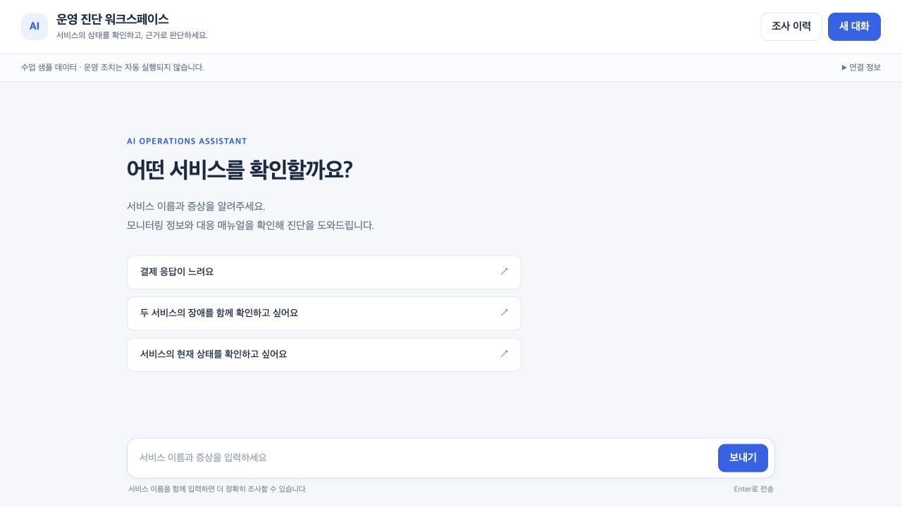
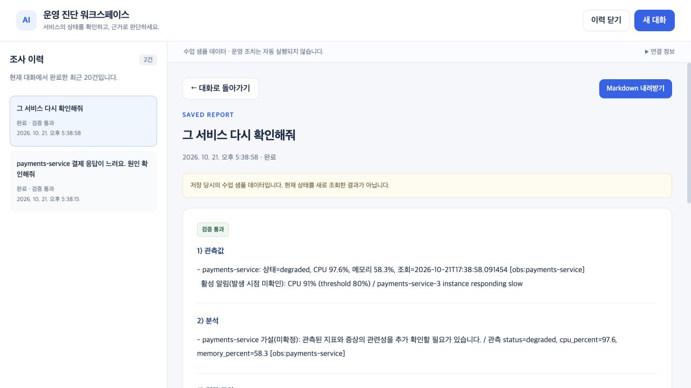

# UI/UX 변경 — 2026-10-21

기존 진단·검증·이력·비교·Markdown 기능을 유지하고 화면 구성을 변경했다.

## 변경 사항

| 영역 | 변경 |
|---|---|
| 전체 | 밝은 배경·파란 강조색, 간격·글자 크기·본문 너비 조정 |
| 첫 화면 | 서비스 이름·증상 입력 안내와 질문 예시. 예시는 입력창만 채우고 자동 전송하지 않음 |
| 채팅 | 사용자/어시스턴트 구분, 검증 전·반려·미통과·통과 상태 유지 |
| 처리 과정 | 진행 중 펼침·완료 후 접기. 종료되지 않은 요청을 완료로 표시하지 않음 |
| 보고서 | 기존 5개 제목이 모두 맞을 때만 영역을 나눔. 일부 초안·일반 대화는 원문 표시 |
| 조사 이력 | 왼쪽 목록과 별도 상세 화면. 선택한 기록·저장 시점·샘플·다운로드 표시 |
| 작은 화면 | 390px에서 이력 패널·상세·대화 복귀·입력창 확인 |
| 연결 정보 | 별도 펼침 영역. fake를 실모델이라고 표시하던 문구 수정 |

## 확인

- Node 기존 대화·SSE·오류·이력·다운로드 회귀 및 새 보고서 분할 검사 통과.
- 원문에 있는 검증 상태·수치·미확인 사항을 보존하며 `v-html`을 사용하지 않는다.
- 실제 브라우저 + MCP + fake 모델에서 질문 예시, 진단, 새로고침 복원, 후속 질문, 비교, 이력 상세와 다운로드 링크 확인.
- 1280px·390px 화면을 확인했다. 변경 후 실제 모델 재호출은 하지 않았고 이번 유료 API 호출은 0회다.
- 백엔드·DB·.env는 바꾸지 않았다. HTML은 파일 응답이라 서버 재시작 없이 화면 새로고침으로 반영된다.

변경 파일: `web_chat.html`, `tests/test_web_session.cjs`. 캡처·이전 소스·검사 로그는 `dev_logs/20261021-ui/`에 있다.

## 제출 파일

최신 UI가 포함된 묶음은 `submission/AI_Mini_Project_Submission_UI.zip`이다. 기존 Phase 7 ZIP과 PPT는 보존했다. 기존 PPT의 화면 캡처는 UI 변경 전의 기능 검증 장면이며 실제 시연은 현재 화면으로 진행한다. 발표 수치·기능·API 계약은 동일하다.

