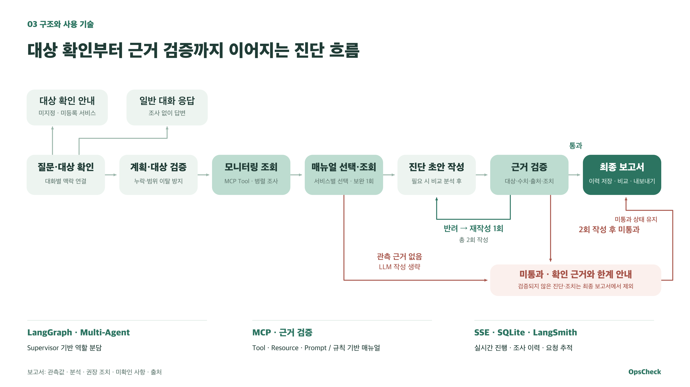

# OpsCheck 발표용 처리 흐름 그래프

현재 프로젝트의 LangGraph v2 경로를 코드와 대조해 만든 요약도입니다. 첨부한 예시의 흰 배경·녹색 계열을 따르고, 구현되지 않은 RAG나 독립 에이전트를 추가하지 않았습니다.

## PPT에 넣을 파일

| 파일 | 용도 |
|---|---|
| [opscheck-flow-slide.png](opscheck-flow-slide.png) | **추천**. 제목·기술 설명 포함, 16:9, 3840×2160. 한 슬라이드 전체에 삽입 |
| [opscheck-flow-diagram.png](opscheck-flow-diagram.png) | **그래프만**. 투명 배경, 3840×1300. 기존 슬라이드에 배치 |
| [opscheck-flow-slide.svg](opscheck-flow-slide.svg) | 슬라이드 구성의 벡터 버전. 확대해도 선명 |
| [opscheck-flow-diagram.svg](opscheck-flow-diagram.svg) | 그래프만 있는 투명 벡터 버전 |
| [opscheck-explore.html](opscheck-explore.html) | 노드와 경로를 탐색하는 보조 미리보기. 고정 UI는 영어이며, 작성한 내용은 한국어 |

PNG는 한글 글꼴이 이미 포함된 픽셀 이미지입니다. SVG 글꼴은 Apple SD Gothic Neo / Malgun Gothic / Noto Sans CJK KR 순으로 대체되므로, 다른 컴퓨터에서 글꼴이 달라지면 PNG를 사용하세요. 기존 PPT 파일은 변경하지 않았습니다.

## 코드와 연결한 내용

- 질문·대상 확인: 일반 대화와 미지정·미등록 서비스는 별도로 응답하고 조사 목록에는 넣지 않음.
- 계획·대상 검증: `plan`과 `gate`를 묶어 조사 대상 누락·범위 이탈을 방지하는 흐름으로 표시.
- 모니터링과 문서: 실제 MCP Tool / Resource를 사용. 서비스별 관측·알림에 따른 규칙 선택이며, 누락 매뉴얼 보완은 최대 1회.
- 비교 분석: 별도 작업이 필요할 때 실행한 후 초안을 작성. 그래프에서는 초안 작성의 보조 설명으로 축약.
- 근거 검증: 대상·수치·출처·조치 검사. 재작성 최대 1회, 총 2회 작성.
- 미통과: 강제 통과하지 않으며, 검증된 가설·조치 없이 확인 근거와 한계를 안내. 보고서와 이력에 미통과 상태를 유지.
- 관측 없음: 매뉴얼 확인 후 작성 가드에서 사용할 관측이 없으면 LLM 작성과 검증을 생략. 요약도에서는 초안 앞의 우회 분기로 표시.
- 완료: 보고서 5개 영역·SQLite 이력·비교·다운로드. 모든 단계의 실제 진행은 SSE, 요청과 하위 호출은 LangSmith로 추적.
- 부분 실패는 성공 관측을 보존한다. 개별 재시도·시간 초과·서버 예외 처리의 세부 선은 이 발표용 요약도에서 생략했다.
- Multi-Agent 표기는 Supervisor 기반 역할 분담을 뜻한다. 모든 그래프 노드가 독립 에이전트나 독립 서브그래프인 것은 아니다.

코드 해시와 위치는 [source-evidence.json](source-evidence.json), 구조·브라우저 검사 결과는 [handoff-receipt.json](handoff-receipt.json)에 기록했습니다. 검사 영수증의 9/9는 Archify JSON·HTML에 적용되며, 별도로 구성한 PPT용 SVG·PNG는 코드 대조·XML·해상도·투명도·이미지 검토로 확인했습니다.

